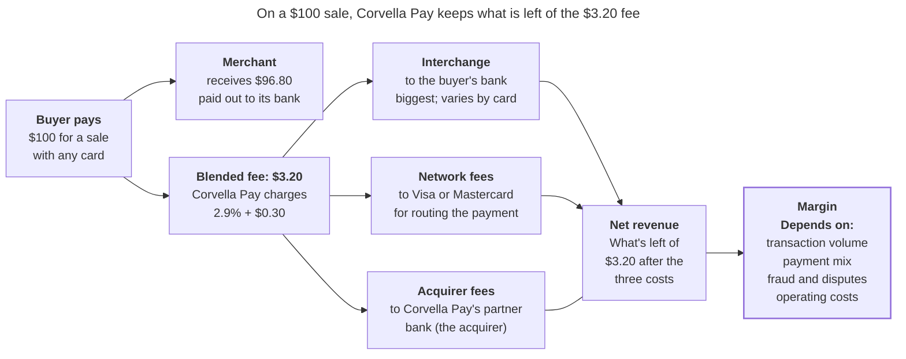
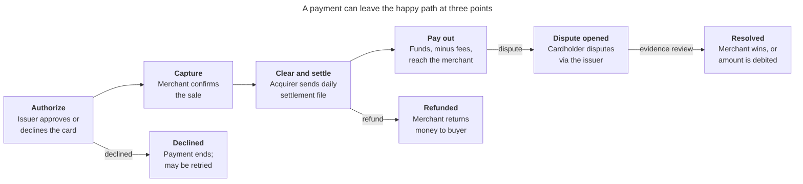
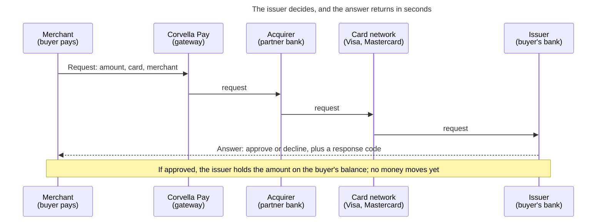
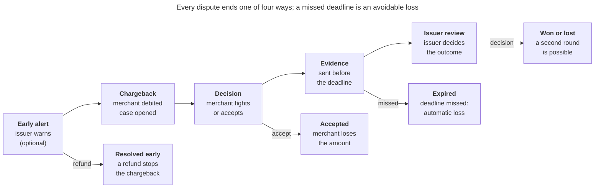

# Corvella Pay — Business Context

## Company

Corvella Pay is a fictional US payment facilitator that lets small and mid-sized merchants accept payments online and in person. You are a Senior Analytics Engineer on its Data Platform team. All company names and figures in this section are invented for the project.

**What it sells.** Corvella Pay helps businesses (its "merchants") get paid by their customers. A business signs up online in a few minutes. It doesn't need to open a special card-acceptance account at a bank, because Corvella Pay handles that bank relationship for it. Corvella Pay offers three things:

- **Online checkout:** the payment step of a website or app, where the buyer types card details and clicks "Pay". A merchant's developers can connect it with code (an API), or the merchant can use a ready-made payment page that Corvella Pay hosts.
- **Point-of-sale (POS) terminals:** the card machines on a shop or restaurant counter, where the buyer taps or inserts a card.
- **Payouts:** Corvella Pay regularly sends the money it collected, minus its fees, to the merchant's bank account.

Buyers can pay with credit or debit cards, with digital wallets (such as Apple Pay or Google Pay, which store a card on the phone), or with ACH bank transfers. **ACH** (Automated Clearing House) is the US network banks use to move money directly from one bank account to another. It's used for payroll, bills and subscriptions. A transfer usually takes one to a few business days.

**How it makes money.** Corvella Pay charges merchants a **blended fee**: 2.9% of the sale plus $0.30, whatever card the buyer uses. A basic debit card usually costs little in interchange, while a premium rewards credit card, a business card or a foreign card costs more. Corvella Pay blends all those different costs into one average price that is easy for a small business to understand. 

The following diagram shows where the money from a $100 card sale goes. The buyer pays $100: the merchant receives $96.80, and Corvella Pay keeps the $3.20 blended fee. Out of that fee, Corvella Pay pays three costs: **interchange** to the buyer's bank (the biggest one), **network fees** to Visa or Mastercard, and fees to its partner bank, the **acquirer**. What's left is its **net revenue**. Its **margin** then depends on how many transactions it processes, which cards the buyers use, how much it loses to fraud and disputes, and what it spends to run the company.

**Scale**

| Metric | Value |
|---|---|
| Active merchants | about 40,000 |
| Annual total payment volume (TPV) | about $12 billion |
| Transactions per year | about 180 million |
| Main merchant segments | e-commerce, subscriptions/SaaS, restaurants, retail |

**The data platform.** Data lands in a Databricks lakehouse governed by Unity Catalog. Main sources: payment gateway events (authorizations, captures, refunds), daily settlement files from the acquiring bank, dispute notifications from the card networks, the merchant onboarding and KYC system, the internal ledger, and the CRM. The Data Platform team owns the shared models that Finance, Risk, Merchant Success and Product use.

## How money moves

Every card payment at Corvella Pay follows the same four steps, and three exits (declined, refund, dispute) from that path create most of the operational work.

Declines happen at authorization, refunds can follow any captured sale, and disputes can arrive weeks or months after the merchant was paid, which makes them late-arriving events in the data.

### The payment lifecycle in depth

The whole lifecycle can be summarized as:

- Information moves in seconds
- Money moves in days
- Disputes can show up months later

That timing gap is why payments data is full of late-arriving events.

#### Who's involved

| Party | Role | Example |
|---|---|---|
| Cardholder | The buyer, who pays with a card | A customer of a coffee shop |
| Merchant | Sells the product and accepts the card | The coffee shop, a Corvella Pay customer |
| Corvella Pay (payment facilitator) | Onboards merchants under its own master account, runs the gateway, and pays merchants out |  |
| Acquirer (acquiring bank) | The bank that sponsors Corvella Pay in the card networks and receives funds on its behalf | A sponsor bank |
| Card network | Routes messages and moves funds between banks, sets the rules (interchange, disputes) | Visa, Mastercard |
| Issuer (issuing bank) | The cardholder's bank, which issued the card and decides whether to approve | The cardholder's bank |

#### The main path

**1. Authorize (seconds).** When the buyer pays, the request travels from the merchant to Corvella Pay's gateway, then to the acquirer, the network, and finally the issuer. The issuer checks whether the card is valid, whether there's enough credit or balance, and whether the transaction looks like fraud. It answers with approve or decline, plus a response code. If approved, the issuer places a hold on the cardholder's available balance. **No money moves yet.** It's a promise that the funds are reserved, and the hold expires if it's never captured.

**2. Capture (seconds to days).** The merchant confirms it wants to collect the authorized amount. Sometimes this happens at the same moment as authorization: a "sale," typical at a store counter. Sometimes it's later: an online shop often captures when the order ships.

The captured amount can differ from the authorized one. A restaurant authorizes the bill, then captures it with the tip added. A shop may capture only part of an order if some items are out of stock. Captures are usually batched and submitted at the end of the day.

**3. Clear and settle (typically 1–2 business days).** These are two steps that usually get described together:

- **Clearing** is the exchange of final transaction details through the network. It is like checking the bill and agreeing on the total amount. The issuer posts the charge to the cardholder's statement, and the network calculates **interchange**, the fee the issuer earns on each transaction.
- **Settlement** is when money actually moves. The issuer pays the network, and the network pays the acquirer the transaction amount minus interchange and network fees. The acquirer credits Corvella Pay's account.

The acquirer then sends a **daily settlement file** listing each transaction with its gross amount, interchange, fees, and net amount. This file is what Finance reconciles against Corvella Pay's own records.

**4. Pay out (on a schedule, e.g. daily).** Corvella Pay pays each merchant through a bank transfer (usually ACH). The payout is a net amount:

> payout = captured sales − refunds − chargebacks − Corvella Pay's fees − reserve held

A **reserve** is a portion of the money Corvella Pay holds back from risky merchants, to cover future refunds or chargebacks it might otherwise have to absorb.

#### The three exits

**Declined (at authorization).** Declines come in two kinds:

- **Soft declines** are temporary, like insufficient funds or the issuer being unavailable. Retrying later can work.
- **Hard declines** are permanent, like an expired card, a closed account, or a card reported stolen. Retrying is useless and can even be penalized by the networks.

Declines can also come from Corvella Pay's own risk engine, which can block a payment before it reaches the issuer.

**Refunded (after capture).** The merchant gives money back voluntarily: full or partial, always referencing the original transaction. The refund travels through clearing as a credit to the cardholder, and Corvella Pay deducts it from the merchant's next payout.

One distinction matters for modeling: before settlement, a merchant can usually **void** the transaction, which simply cancels it. After settlement, it must be a **refund**, which is a new money movement in the opposite direction.

**Dispute opened (after settlement, sometimes much later).** The cardholder contacts their bank, not the merchant, to contest the charge, for example claiming fraud, an item not received, or a cancelled subscription. The issuer files a chargeback through the network with a **reason code**. The money is immediately pulled back from the acquirer, then from Corvella Pay, which debits the merchant, usually with a fee. On a single order, the merchant has the order value at risk plus a dispute fee, commonly $15 to $25, plus 20 to 45 minutes of evidence work ([Redo](https://redo.com/articles/chargebacks/chargeback-statistics)).

Cardholders can dispute long after the purchase; for many reason codes, the window is around 120 days. That's why a dispute is a classic late-arriving event: the merchant may have been paid weeks earlier.

**Resolved (weeks).** The merchant can fight the dispute by submitting evidence before a deadline (called representment): tracking numbers, receipts, proof of service. The issuer decides. If the merchant wins, the money returns. If it loses or doesn't respond in time, the debit stands. The issuer can also escalate to a second cycle, which delays the outcome further.

Two numbers show how hard this is: merchants win about 44.6% of the chargebacks they represent, but net recovery across all chargebacks is just 10.7% ([Chargebacks911 via Redo](https://redo.com/articles/chargebacks/chargeback-statistics)).

Winning a dispute also doesn't make it disappear. Visa watches each merchant's **dispute rate**: the share of its payments that get disputed. Every dispute counts in that rate, even the ones the merchant wins; winning only brings the money back. For example, if 2 out of every 100 payments of a merchant are disputed, its dispute rate is 2%, above Visa's 1.5% limit for merchants with enough volume, even if the merchant wins all of them. Visa also watches the dispute rate of all of Corvella Pay's merchants together. If that combined rate gets too high, the acquirer can penalize Corvella Pay or end the partnership, so Corvella Pay needs to spot merchants with rising dispute rates early.

#### Data produced at each stage

Each stage of the money path produces its own records, from its own source system. The tables below follow one example payment (`pay_8F3K2Q`, a $100 credit card purchase in an online clothing store) through every stage. Column names, types (Spark SQL) and values are invented for the project and are a starting point for the synthetic source data. The full card number is never stored; only the first six digits (the BIN, which identifies the issuer) and the last four.

**1. Authorization event** (gateway, real time)

| Column | Type | Example | Meaning |
|---|---|---|---|
| authorization_id | STRING | auth_7Q2M9X | Unique ID of this authorization attempt |
| payment_id | STRING | pay_8F3K2Q | Links every record of the same payment |
| merchant_id | STRING | mer_00412 | The merchant selling the product |
| event_ts | TIMESTAMP | 2026-10-14 15:32:07 | When the attempt happened |
| amount | DECIMAL(18,2) | 100.00 | Amount requested |
| currency | STRING | USD | Currency of the amount |
| channel | STRING | card_not_present | Online (card not present) or in store (card present) |
| card_brand | STRING | visa | Card network |
| card_type | STRING | credit | credit, debit or prepaid |
| card_bin | STRING | 411111 | First six digits; identify the issuer |
| card_last4 | STRING | 4242 | Last four digits |
| issuer_country | STRING | US | Country of the buyer's bank |
| mcc | STRING | 5651 | Merchant category code (5651 = clothing stores) |
| risk_score | DECIMAL(5,4) | 0.1200 | Corvella Pay's fraud score, 0 to 1 |
| status | STRING | approved | approved or declined |
| response_code | STRING | 00 | Issuer's answer (00 = approved, 51 = insufficient funds) |
| decline_type | STRING | null | soft or hard, only when declined |
| auth_code | STRING | 834201 | Approval code returned by the issuer |

**2. Capture event** (gateway, seconds to days later)

| Column | Type | Example | Meaning |
|---|---|---|---|
| capture_id | STRING | cap_3J8D1L | Unique ID of the capture |
| payment_id | STRING | pay_8F3K2Q | The payment being captured |
| authorization_id | STRING | auth_7Q2M9X | The authorization it collects |
| event_ts | TIMESTAMP | 2026-10-15 09:10:44 | When the merchant confirmed the sale |
| captured_amount | DECIMAL(18,2) | 100.00 | Can differ from the authorized amount |
| capture_type | STRING | full | full or partial |
| batch_id | STRING | bat_20261015_01 | End-of-day batch sent for clearing |

**3. Settlement file line** (acquirer, one row per transaction, 1–2 business days later)

| Column | Type | Example | Meaning |
|---|---|---|---|
| settlement_date | DATE | 2026-10-16 | Day the money moved |
| file_name | STRING | acq_settlement_20261016.csv | Daily file it came from |
| acquirer_reference | STRING | 24692166289000012345678 | Reference number the networks use for this transaction |
| payment_id | STRING | pay_8F3K2Q | Corvella Pay's reference, used to match the line |
| transaction_type | STRING | sale | sale or refund |
| gross_amount | DECIMAL(18,2) | 100.00 | Transaction amount |
| interchange_fee | DECIMAL(18,2) | 2.10 | Paid to the buyer's bank |
| network_fee | DECIMAL(18,2) | 0.14 | Paid to Visa or Mastercard |
| acquirer_fee | DECIMAL(18,2) | 0.20 | Paid to the acquirer |
| net_amount | DECIMAL(18,2) | 97.56 | What Corvella Pay receives for this line |
| currency | STRING | USD | Currency |

**4. Merchant payout** (internal ledger, on the payout schedule)

| Column | Type | Example | Meaning |
|---|---|---|---|
| payout_id | STRING | po_20261017_00412 | Unique ID of the payout |
| merchant_id | STRING | mer_00412 | Merchant being paid |
| payout_date | DATE | 2026-10-17 | Day the transfer was sent |
| gross_sales | DECIMAL(18,2) | 4850.00 | Captured sales included |
| refunds | DECIMAL(18,2) | 40.00 | Refunds deducted |
| chargebacks | DECIMAL(18,2) | 0.00 | Chargebacks deducted |
| corvella_fees | DECIMAL(18,2) | 152.60 | Blended fees on the included sales |
| reserve_held | DECIMAL(18,2) | 242.50 | Amount held back for risk |
| net_payout | DECIMAL(18,2) | 4414.90 | Amount sent to the merchant's bank |
| transfer_method | STRING | ACH | How the money was sent |
| status | STRING | paid | pending, paid or failed |

Each payout also has one line per included transaction or adjustment, so a payment can be traced to the payout that paid it.

**5. Refund or void event** (gateway, after capture)

| Column | Type | Example | Meaning |
|---|---|---|---|
| refund_id | STRING | ref_9M4T6B | Unique ID of the refund |
| payment_id | STRING | pay_8F3K2Q | Original payment |
| event_ts | TIMESTAMP | 2026-10-20 13:45:12 | When the merchant issued it |
| refund_type | STRING | refund | void (before settlement) or refund (after) |
| refund_amount | DECIMAL(18,2) | 40.00 | Can be partial |
| reason | STRING | customer_return | Merchant's stated reason |

**6. Dispute notification** (card network, weeks to months later)

| Column | Type | Example | Meaning |
|---|---|---|---|
| dispute_id | STRING | dsp_K82J1A | Unique ID of the dispute |
| payment_id | STRING | pay_8F3K2Q | Disputed payment |
| acquirer_reference | STRING | 24692166289000012345678 | Used to match the network's notice to the payment |
| received_ts | TIMESTAMP | 2026-12-02 11:05:00 | When the notice arrived |
| dispute_amount | DECIMAL(18,2) | 100.00 | Amount pulled back |
| network | STRING | visa | Network that sent it |
| reason_code | STRING | 13.1 | Network's code for the reason |
| reason_category | STRING | merchandise_not_received | Readable group of the reason |
| stage | STRING | first_chargeback | Stage of the dispute process |
| respond_by | DATE | 2026-12-22 | Deadline to submit evidence |
| dispute_fee | DECIMAL(18,2) | 15.00 | Fee charged to the merchant |

**7. Dispute resolution** (card network, weeks later)

| Column | Type | Example | Meaning |
|---|---|---|---|
| dispute_id | STRING | dsp_K82J1A | Dispute being resolved |
| evidence_submitted_ts | TIMESTAMP | 2026-12-10 16:20:00 | When the merchant sent evidence (null if none) |
| outcome | STRING | won | won or lost |
| resolved_ts | TIMESTAMP | 2027-01-08 10:00:00 | When the issuer decided |
| amount_recovered | DECIMAL(18,2) | 100.00 | Money returned to the merchant |
| final_stage | STRING | first_chargeback | Stage where it ended (or a second cycle) |

#### What this means for the data

Each box produces data at a different time, from a different source:

| Step | When it arrives | Source |
|---|---|---|
| Authorization, decline | Real time | Gateway events |
| Capture, void, refund | Seconds to days | Gateway events |
| Clearing and settlement | 1–2 business days | Acquirer settlement file |
| Payout | Payout schedule | Internal ledger |
| Dispute, resolution | Weeks to months | Network dispute notifications |

This is why payments are such good material for the roadmap. A single payment is a lifecycle with milestones (an accumulating snapshot). Its events arrive late and from separate systems (late-arriving facts). And proving that the gateway, settlement file and ledger agree is reconciliation work.

## The Business Problem: Disputes and Chargebacks

The most painful area at Corvella Pay today is related to disputes and chargebacks. The company is losing money, and the dispute rate is putting its acquirer relationship at risk, and hitting merchants directly. The data is scattered, late and inconsistent: Disputes Operations can't prioritize cases before their deadlines, Risk can't spot merchants trending toward Visa's limits in time, and the company can't agree on, or explain, its own dispute numbers.

### What the business is seeing

Over the last twelve months, the leadership team has noticed five symptoms:

- **The portfolio's dispute rate is rising.** Disputes went from 0.31% to 0.46% of all transactions. Visa's "above standard" line for an acquirer's whole portfolio is 0.50%, and the acquirer has sent Corvella Pay a formal warning asking for an action plan.
- **Disputes are lost by missing the deadline.** About 1 in 5 disputes (18%) is lost without any evidence being submitted, simply because the response deadline passed. These are losses Corvella Pay could have fought.
- **Risky merchants are found too late.** Three merchants passed Visa's merchant-level limit last quarter before anyone at Corvella Pay noticed. In each case, the problem only appeared in the monthly risk report, weeks after the disputes started growing.
- **Corvella Pay absorbs losses it can't recover.** When a merchant with many disputes closes its account or has no balance left, Corvella Pay pays the chargebacks itself. These unrecovered losses reached $1.9 million last year.
- **Nobody agrees on the numbers.** Risk, Finance and Disputes Operations each report a different dispute rate for the same month, and meetings start with arguments about whose number is right.

### Why the business thinks this is happening

When asked, each team describes the problem from its own point of view:

- **Disputes Operations:** "Dispute notices arrive from Visa and Mastercard in separate portals and files. For every case, an analyst has to look up the original payment, the capture, the refunds and the merchant's details in different systems before contacting the merchant. That takes hours per case, the queue is not sorted by deadline or amount, so cases close to their deadline get lost in the pile."
- **Risk:** "We calculate dispute rates by hand in a spreadsheet once a month, after the month closes. By then it's too late to act. We also can't see which merchants are trending toward the limit, so we can't raise their reserve or warn them in time."
- **Finance:** "We count a dispute in the month of the original sale; Risk counts it in the month the dispute arrived. Both are reasonable, but nobody has defined which one is official, so the numbers never match."
- **Merchant Success:** "Merchants ask us why they are getting disputes and how to avoid them, and we have no answer. We don't know which reason codes, products or merchant types cause most disputes, or which disputes are worth fighting."

### The underlying data problems

Behind those explanations, the Data Platform team sees a common set of causes:

1. **Data lives in silos.** Payments come from the gateway, disputes from the card networks, money movements from the ledger and merchant details from the onboarding system. Nothing connects them in one place.
2. **Disputes are hard to link to the original payment.** A dispute arrives weeks or months after the sale, identified by the network's reference number, and matching it to the payment is partly manual.
3. **History is overwritten.** When a dispute changes status (opened, evidence submitted, won), the old status is replaced, so nobody can measure how long each step took or reconstruct what the queue looked like on a past date.
4. **Merchant attributes change, and reports use today's values.** A merchant's risk tier or segment changes over time, but reports always show the current one, which distorts past dispute rates by segment.
5. **Metrics have no single definition.** Dispute rate, win rate and loss amounts are calculated differently in each team's spreadsheet.
6. **Everything is batch and manual.** The data needed to act arrives in monthly reports instead of daily views.

## The dispute process at Corvella Pay

This section describes how a dispute moves through Corvella Pay, step by step. It is a simplified but realistic version: real Visa and Mastercard rules are more complex and differ between networks, and the deadlines and internal rules below are assumptions for the project.

### Steps of a dispute

1. **Early alert (optional).** Before filing a formal chargeback, the issuer can send an alert through the network saying the cardholder is unhappy. If the merchant refunds the payment quickly, the case ends there. This matters because disputes resolved this way are not counted in Visa's dispute rate ([Redo](https://redo.com/articles/chargebacks/chargeback-statistics)).
2. **Chargeback received.** The network notice arrives with the amount, a reason code and a response deadline. Corvella Pay immediately debits the amount and a dispute fee from the merchant's balance, and a case is opened in the Disputes Operations queue.
3. **Decision.** Disputes Operations links the case to the original payment and notifies the merchant. The merchant decides whether to fight or accept. Corvella Pay automatically accepts disputes under $25, because fighting them costs more than the amount at stake.
4. **Evidence.** If the merchant fights, it uploads evidence (receipt, tracking number, proof of delivery or service). Disputes Operations checks it and submits it to the network before the deadline. If nothing is submitted in time, the dispute **expires** and is lost automatically.
5. **Issuer review.** The issuer reviews the evidence and decides. If the merchant wins, the money returns. If it loses, the debit stands. A win is not always the end, though. The cardholder can come back with new information (for example, "the item arrived, but it was broken"), and the issuer can then challenge the merchant's win one more time. This **second round** is called **pre-arbitration**: the merchant again chooses to accept the loss or respond with more evidence, under a new deadline. If the two sides still disagree after that, either one can ask the card network to decide. This is **arbitration**: the network's decision is final, and the losing side pays a high fee, often several hundred dollars, so it is rare and only worth it for large amounts. For the data, this means a dispute can go through more than one cycle, and its status can change several times before it ends.

Every dispute ends in one of four ways: **resolved early**, **accepted**, **expired**, or **won or lost** after review. Expired disputes are the avoidable ones: the merchant may have had a case, but it was never presented.

### Who does what

| Actor | Role in the process |
|---|---|
| Cardholder | Contests the charge with their bank |
| Issuer | Files the chargeback, reviews the evidence, decides the outcome |
| Card network | Carries notices and evidence between issuer and acquirer, sets the rules and deadlines |
| Acquirer | Passes the chargeback to Corvella Pay and watches its portfolio's dispute rate |
| Disputes Operations (Corvella Pay) | Opens cases, notifies merchants, reviews and submits evidence, tracks deadlines |
| Merchant | Decides to fight or accept, provides evidence |
| Risk (Corvella Pay) | Monitors dispute rates per merchant and for the portfolio, sets reserves, acts on risky merchants |
| Finance (Corvella Pay) | Records dispute losses, fees and recoveries; tracks unrecovered losses |
| Merchant Success (Corvella Pay) | Helps merchants understand and prevent disputes |

### Deadlines (project assumptions)

| Deadline | Time limit | What happens if missed |
|---|---|---|
| Cardholder can dispute | Up to 120 days after the purchase | The issuer can't file the dispute |
| Network response deadline | 30 days after the chargeback arrives | The dispute expires and is lost |
| Merchant sends evidence to Corvella Pay | 20 days after the chargeback arrives | Disputes Operations has no time to review it |
| Disputes Operations submits to the network | 28 days after the chargeback arrives | Two days of buffer before the network deadline |
| Response to a second round | 30 days after it arrives | The second round is lost |

### How money moves during a dispute

| Event | Merchant's balance | Effect on Corvella Pay |
|---|---|---|
| Chargeback received | Debited by the amount plus the dispute fee | Corvella Pay has already returned the money to the acquirer, so it depends on recovering it from the merchant |
| Merchant wins | Amount credited back; the fee usually stays charged | Money recovered |
| Merchant loses, accepts, or the dispute expires | The debit stands | No further movement |
| Merchant can't pay (no balance, account closed) | Balance goes negative | Corvella Pay uses the merchant's reserve first; whatever the reserve doesn't cover is an **unrecovered loss** Corvella Pay absorbs |

### Monitoring dispute rates

Separately from handling individual cases, Risk watches dispute rates and acts on merchants before they cause trouble:

- **Per merchant:** Corvella Pay puts a merchant on a watch list when its dispute rate passes 0.75% (half of Visa's 1.5% merchant limit). Actions grow with the risk: warn the merchant and involve Merchant Success, raise its reserve, hold part of its payouts, and as a last resort close its account.
- **For the whole portfolio:** Risk tracks the combined dispute rate of all merchants against the acquirer's 0.50% line, because crossing it threatens the acquirer relationship.

Today this monitoring runs monthly in a spreadsheet. The goal of the project is to make it daily and reliable.

### Prevention

The cheapest dispute is the one that never becomes a chargeback. Corvella Pay has two levers: responding to early alerts with quick refunds, and Merchant Success advising merchants on what causes disputes (unclear billing names on card statements, missing delivery confirmation, hard-to-cancel subscriptions). Both depend on knowing which reason codes and merchant types drive most disputes.

## Business questions

These are the questions the solution must answer. They come straight from the symptoms in the business problem, grouped by the team that asks them most. Questions 16 and 17 are about the past, and they need the data to keep its history instead of overwriting it.

### Case operations (Disputes Operations)

| # | Question | Why it matters |
|---|---|---|
| 1 | Which open disputes are closest to their deadline, and how much money is at stake in each? | Lets the team work the queue in the right order, so cases stop expiring |
| 2 | Which cases are waiting for the merchant's evidence, and for how long? | Shows where to chase merchants before the internal 20-day limit |
| 3 | How many disputes expired in a period, and at which step did they stall? | Measures the 18% loss to missed deadlines and shows where the process breaks |
| 4 | How long does each step take, from chargeback received to evidence submitted? | Finds the slow steps and checks whether the 28-day target is realistic |

### Risk monitoring (Risk)

| # | Question | Why it matters |
|---|---|---|
| 5 | What is each merchant's dispute rate today, and how has it moved over the last 30 and 90 days? | Replaces the monthly spreadsheet with a daily view of the trend |
| 6 | Which merchants are above the 0.75% watch line, and which are approaching Visa's 1.5% limit? | Catches risky merchants before they cross the limit, not after |
| 7 | What is the portfolio's dispute rate against the acquirer's 0.50% line, and which merchants contribute most to it? | Answers the acquirer's warning and focuses action on the merchants that matter |
| 8 | Is each risky merchant's reserve enough to cover its open disputes? | Prevents losses Corvella Pay would otherwise absorb |

### Financial impact (Finance)

| # | Question | Why it matters |
|---|---|---|
| 9 | How much did disputes cost in a period: amounts lost, fees, money recovered and unrecovered losses? | Shows the true cost of disputes, including the $1.9 million absorbed last year |
| 10 | How much money is at risk right now in open disputes? | Helps Finance plan for losses that haven't happened yet |
| 11 | What is the dispute rate counted by sale month, and counted by dispute month? | Ends the argument between Risk and Finance: both views, clearly named, from the same data |

### Causes and prevention (Merchant Success and Risk)

| # | Question | Why it matters |
|---|---|---|
| 12 | Which reason codes, merchant segments and merchant categories cause most disputes? | Tells merchants what to fix and where prevention pays off |
| 13 | What is the win rate by reason code, and which disputes are worth fighting? | Puts effort into winnable cases instead of hopeless ones |
| 14 | How many disputes were resolved early through alerts, and how many could have been? | Measures prevention, which also lowers the dispute rate Visa counts |
| 15 | How does a given merchant's dispute profile compare with similar merchants? | Gives Merchant Success a concrete answer when merchants ask why |

### Looking back in time

| # | Question | Why it matters |
|---|---|---|
| 16 | What were dispute rates by merchant segment and risk tier, using each merchant's segment and tier at the time of the sale? | Today's reports use current values, which distorts past numbers |
| 17 | What did the open dispute queue look like on any past date? | Explains past expirations and shows whether the backlog is improving |

## Decisions the solution supports

Answering questions is only useful if someone acts on the answer. These are the decisions the solution will inform. People still make them; the solution gives them reliable, timely data. The "How often" column will later drive the latency requirements: a daily decision needs data that is at most a day old.

| # | Decision | Who decides | How often | Questions used | Possible actions |
|---|---|---|---|---|---|
| D1 | Which dispute cases to work on first | Disputes Operations analysts | Daily | 1, 2 | Reorder the queue by deadline and amount; chase merchants who haven't sent evidence |
| D2 | Whether to fight or accept a dispute | The merchant, with a recommendation from Disputes Operations | Per case | 13 | Fight with evidence, or accept the loss |
| D3 | Where to set the automatic-acceptance limit (today $25) | Disputes Operations manager | Quarterly | 9, 13 | Raise or lower the limit |
| D4 | Whether to change how the dispute process is run | Disputes Operations manager | Monthly | 3, 4, 17 | Add staff at peak times, change internal deadlines, automate the slowest step |
| D5 | Whether to act on a risky merchant, and how strongly | Risk | Daily review, weekly action | 5, 6, 8 | Watch list, warning, higher reserve, payout hold, or closing the account |
| D6 | How much reserve to hold for each merchant | Risk | Weekly | 8, 10 | Raise, keep or release reserves |
| D7 | What action plan to present to the acquirer, and which merchants to focus on | Head of Risk, with leadership | Monthly | 7, 9 | Commit to targets for the portfolio dispute rate and to actions on the merchants contributing most |
| D8 | How much money to set aside for dispute losses | Finance | Monthly close | 9, 10, 11 | Adjust the provision for losses in the financial statements |
| D9 | Which merchants to contact with prevention advice, and what to tell them | Merchant Success | Weekly | 12, 14, 15 | Targeted outreach: clearer billing names, delivery confirmation, easier cancellation |
| D10 | Whether to extend early-alert coverage | Payments Product and Risk | Quarterly | 14 | Enroll more merchants or networks in alert programs |
| D11 | Whether to change onboarding rules for high-risk merchant types | Risk | Quarterly | 12, 16 | Stricter checks or higher starting reserves for those segments |

The two most urgent are D1 and D5. D1 attacks the losses from missed deadlines, and D5 attacks the rising dispute rate behind the acquirer's warning. Both are made daily, so they set the bar for how fresh the data must be.

## Main metrics

Each metric below has one official definition. That is what ends the "whose number is right" arguments: every team uses the same formula, built once in the semantic layer. The "Used for" column links each metric to the decisions above.

**Counting rules that apply to every metric:**

- A **dispute** is a formal chargeback. A second round on the same payment is part of the same dispute, not a new one. Early alerts resolved with a refund are not disputes.
- A **sale** is a settled card payment. Declined or voided payments are not sales.
- Amounts are in US dollars.
- **Period:** unless a metric says otherwise, it is reported by calendar month and can also be filtered by day or week. Each record counts on the date of its own event: a sale on its settlement date, a dispute on the date it was received, and a closed dispute on the date it reached its final outcome.

### Dispute rates

| # | Metric | Definition | Used for |
|---|---|---|---|
| M1 | **Dispute rate** (monitoring view) | Disputes received in a calendar month ÷ sales settled in the same month. Calculated per merchant and for the whole portfolio. | D5, D7: compared with the 0.75% watch line, Visa's 1.5% merchant limit and the acquirer's 0.50% line |
| M2 | **Dispute rate by sale month** (cohort view) | For a sales month M at an age of N days: disputes on sales settled in month M, received up to N days after the last day of M ÷ sales settled in month M. The value is cumulative and only grows with age. It is reported at standard ages of 30, 60, 90 and 120 days after the month ends, and a month is considered mature at 120 days. Months are compared only at the same age. | D8, D11: Finance's view of how risky a month's sales turned out |
| M3 | **Rolling 30-day dispute rate** | M1 over the last 30 days, recalculated every day, compared with the previous 30 days | D5: spots merchants trending up before they cross a line |
| M4 | **Disputed amount rate** | Disputed amount ÷ settled sales amount, for the same period as M1 | D7, D8: the money view of M1, since a few large disputes can matter more than many small ones |
| M5 | **Merchants on the watch list** | Number of merchants with M3 above 0.75%, and number above 1.5% | D5, D7 |

### Case operations

| # | Metric | Definition | Used for |
|---|---|---|---|
| M6 | **Expiry rate** | Disputes that expired ÷ disputes closed, both counted by closing date in the same calendar month. A dispute is closed when it reaches a final outcome: won, lost, accepted or expired. An expired dispute closes on its network deadline. | D4: the main measure of the missed-deadline problem (18% today) |
| M7 | **Disputes near deadline** | Number and amount of open disputes whose network deadline is 5 days away or less | D1: what to work on today |
| M8 | **Time per step** | Median days from chargeback received to merchant notified, to evidence received, and to evidence submitted | D4: finds the slow step |
| M9 | **Fight rate** | Disputes fought ÷ disputes received, excluding those accepted automatically | D2, D3 |

### Outcomes and money

| # | Metric | Definition | Used for |
|---|---|---|---|
| M10 | **Win rate** | Disputes won ÷ disputes fought that have a final outcome | D2, D3: shown by reason code to decide which disputes are worth fighting |
| M11 | **Net recovery rate** | Amount recovered ÷ total disputed amount | D3, D7: the overall result of the process |
| M12 | **Dispute losses** | Disputed amount lost (lost, accepted or expired) plus dispute fees, in a period | D8 |
| M13 | **Unrecovered losses** | Part of the dispute losses Corvella Pay paid itself because the merchant's balance and reserve didn't cover it | D6, D8: the $1.9 million problem |
| M14 | **Open exposure** | Total amount of disputes still open | D8, D6 |
| M15 | **Reserve coverage** | A merchant's reserve ÷ its open exposure | D6: below 100% means Corvella Pay could absorb part of the loss |

### Prevention

| # | Metric | Definition | Used for |
|---|---|---|---|
| M16 | **Early resolution rate** | Alerts resolved with a refund ÷ (alerts resolved + disputes received) | D9, D10: how much prevention is working |
| M17 | **Dispute mix** | Share of disputes by reason code, merchant segment and merchant category | D9, D11: where prevention efforts should go |

**The two headline metrics** are the portfolio dispute rate (M1), which answers the acquirer's warning, and the expiry rate (M6), which measures the avoidable losses. If the solution works, M1 moves away from the 0.50% line and M6 falls well below today's 18%.

## How frequently the information changes

The data the solution needs changes in two different ways: **new records arrive** (new payments, new disputes), and **existing records change** (a dispute moves to a new status, a merchant gets a new risk tier). The second kind is the one that shapes the model, because it decides whether history must be kept. Volumes are fictional and consistent with Corvella Pay's scale (about 180 million transactions a year).

| Data | Source | New records | How existing records change | Daily volume (fictional) | What it means for the model |
|---|---|---|---|---|---|
| Payment events (authorization, capture, refund, void) | Gateway | Continuously, all day | Never: each event is a new record. A payment gains events over its first days. | About 500,000 payments | Append-only transaction facts, loaded incrementally |
| Settlement lines | Acquirer's daily file | Once per business day | Rarely: corrections arrive as new lines in later files | About 500,000 lines | Append-only; corrections handled as adjustments, not overwrites |
| Dispute notifications | Card networks | Several times a day, on business days | Each dispute changes status 3 to 6 times over 30 to 90 days, and a second round can reopen it | About 2,300 new disputes, plus status updates on open ones | Accumulating snapshot of each dispute, plus a status history so no change is lost |
| Case actions (merchant notified, evidence received, evidence submitted) | Disputes Operations case system | Many times a day | Today the case record is overwritten on each update | Several thousand updates | Capture each action as an event with its timestamp, to measure time per step (M8) |
| Early alerts | Card networks' alert programs | Continuously | Resolved within 24 to 72 hours | A few hundred | Small event table; short-lived |
| Merchants | Onboarding and risk systems | About 100 new merchants a day | Risk tier and reserve rate reviewed weekly; segment and category change rarely | About 40,000 merchants, a few hundred changes a day | Slowly changing dimension type 2, so reports can use the values at the time of the sale |
| Reserves, balances and payouts | Internal ledger | Daily, with each payout run | Balances change every day | About 40,000 merchant balances | Daily periodic snapshot of each merchant's balance and reserve |
| Reference data (reason codes, merchant categories) | Card networks | Rarely | Networks update reason codes a few times a year | Hundreds of rows | Small dimensions, versioned when the networks change them |
| Policy thresholds (0.75% watch line, $25 auto-accept limit, Visa's lines) | Internal policy and network rules | Rarely | Changed by management or by the networks | A handful of values | Kept with effective dates, so past reports use the threshold that applied at the time |

**In short:** payments arrive fast but never change, disputes arrive slowly but change for months, and merchants change slowly but must be remembered as they were. That mix leads to three different modeling patterns in the same solution: transaction facts, an accumulating snapshot, and a type 2 dimension.

## Who will consume the data

The consumers differ in what they need, how often they look, and how comfortable they are with data. That decides the interface each one gets: a work queue, a dashboard, governed tables for SQL, or an AI assistant. Team sizes are fictional.

### People inside Corvella Pay

| Consumer | What they need | Decisions | How they use it | Data skills |
|---|---|---|---|---|
| **Disputes Operations analysts** (about 12 people) | Open disputes with deadline, amount, status and the linked payment, sorted by urgency | D1, D2 | A daily work-queue dashboard, case by case | Low: no SQL, need a ready-made list |
| **Disputes Operations manager** | Expiry rate, time per step, fight and win rates | D3, D4 | Weekly and monthly dashboard | Medium |
| **Risk analysts** (about 5 people) | Dispute rates per merchant and their trend, watch list, reserve coverage | D5, D6 | Daily dashboard, plus their own SQL queries in Databricks | High: write SQL |
| **Head of Risk and leadership** | Portfolio dispute rate against the acquirer's line, main contributing merchants, total losses | D7 | Monthly executive dashboard and the report sent to the acquirer | Low: need the headline and the trend |
| **Finance** | Dispute losses, unrecovered losses, open exposure, the cohort dispute rate | D8 | Monthly report for the close, often exported to spreadsheets | Medium |
| **Merchant Success managers** (about 20 people) | Each merchant's dispute profile compared with similar merchants, main reason codes | D9 | Merchant-level dashboard, before calls with merchants | Low |
| **Payments Product** | Early-alert coverage and results | D10 | Quarterly analysis | Medium |
| **Data analysts and data scientists** | Clean, governed tables to explore and, later, to train a model that predicts disputes | All, indirectly | SQL and PySpark on the governed tables in Unity Catalog | High |

### AI assistant

Risk, Finance and Disputes Operations will also ask questions in plain language through an AI/BI Genie space built on top of the governed tables and metric definitions (for example, "which merchants in the restaurant segment crossed the watch line this week?"). It is a consumer like the others, with one extra need: clear table descriptions and precise metric definitions, because the quality of its answers depends on them.

### Outside Corvella Pay (indirect)

| Consumer | What they receive | Notes |
|---|---|---|
| **The acquirer** | A monthly report on the portfolio dispute rate and the action plan | No direct access; the report is built from the solution |
| **Merchants** | Their own dispute rate and main causes, in Corvella Pay's merchant dashboard | Future phase, not part of the first version |

### Priorities for the first version

The first version serves **Disputes Operations** (the work queue behind D1) and **Risk** (the daily monitoring behind D5), because they address the two most urgent problems: missed deadlines and the acquirer's warning. Finance comes next, then Merchant Success. Each group also needs different access, for example card details or only its own merchants; that is covered under constraints.

## Latency, accuracy, retention and history requirements

These requirements turn the earlier answers (decisions, consumers, how often data changes) into targets the solution must meet. They are project assumptions, set from the business needs rather than from technology preferences.

### Latency: how fresh the data must be

| Use | Freshness target | Why |
|---|---|---|
| Disputes Operations work queue (D1) | New disputes and status changes visible within 1 hour, refreshed hourly from 8:00 to 20:00 (US Eastern time) | Analysts work the queue all day; a dispute that arrives in the morning should be in the queue the same morning |
| Risk monitoring: dispute rates, watch list, reserve coverage (D5, D6) | Daily, ready by 8:00 with data up to the end of the previous day | Risk reviews daily; a one-day delay is acceptable, a one-month delay is the current problem |
| Finance, leadership, Merchant Success dashboards | Daily | Their decisions are weekly or monthly |
| Month-end figures for Finance and the acquirer report (D7, D8) | Final by the 3rd business day of the next month | Fits the monthly close |
| AI assistant (Genie) | Same as the tables it reads | It is only as fresh as its data |

No use needs real-time data. Deadlines are measured in days, so hourly batches are enough, and streaming would add cost and complexity without changing any decision.

### Accuracy: how correct the data must be

| Aspect | Requirement | How it will be checked |
|---|---|---|
| Completeness | Every dispute notification received is loaded | Daily count of disputes per network file matches the count in the model |
| Money | Amounts exact to the cent | Daily total of disputed amounts matches the network files, with zero difference |
| Deadlines | 100% correct; a wrong deadline means a lost dispute | Stored exactly as the network sends them, in UTC, and shown in US Eastern time |
| Link to the original payment | At least 99.5% of disputes linked to their payment within 24 hours | Unmatched disputes go to a separate list, visible in the work queue, for manual matching |
| Uniqueness | One dispute per payment and dispute ID, whatever the number of rounds | Automated uniqueness test |
| Metric consistency | The same number for the same metric everywhere | Metrics defined once in the semantic layer; dashboards and the AI assistant read from it |
| Incomplete days | Dispute rates are marked as preliminary when the settlement file for a day is late | Freshness check on the settlement data |

### Retention: how long data is kept

| Data | Kept for | Notes |
|---|---|---|
| Payments, settlement lines, disputes, status history, payouts | 7 years | Assumed Corvella Pay policy for financial records |
| Raw source files as received | 13 months in the raw layer, then archived to cheaper storage until 7 years | Allows reprocessing recent data if a bug is found |
| Daily snapshots (open disputes, merchant balances and reserves) | 7 years | Needed to answer questions about past dates |
| Card details | Only the first six and last four digits, never the full card number | Card-industry security rules; detailed under constraints |

Delta Lake's time travel (reading a table as it was at an earlier version) is kept short, for recovering from mistakes. It is not the way business history is stored, because old versions are cleaned up over time.

### History: what must be remembered, and how

| Data | History requirement | Approach |
|---|---|---|
| Disputes | Every status change, with its timestamp | A status history table (one row per change), plus an accumulating snapshot with one row per dispute and the date of each milestone |
| Case actions | Every action (merchant notified, evidence received, evidence submitted) | Event records with timestamps, so time per step (M8) can be measured |
| Merchants | Risk tier, segment, category, reserve rate and status as they were at any date | Slowly changing dimension type 2; simple corrections (a typo in a name) overwrite instead |
| Open dispute queue | What the queue looked like on any past date (question 17) | Daily snapshot of open disputes |
| Merchant balances and reserves | Value at the end of each day | Daily periodic snapshot |
| Policy thresholds | The value that applied on any date | Stored with effective dates |
| Reports sent to the acquirer | The exact numbers that were sent | Frozen copy of each monthly report, since later corrections must not change what was already reported |

**Starting history:** at launch, the solution loads 24 months of past data, so trends, rolling rates and mature sales-month cohorts (which need 120 days) are available from day one.

## Constraints

Constraints are the limits the solution must respect, whatever design is chosen. Figures and policies are assumptions for the project.

### Compliance and security

| Constraint | What it means for the solution |
|---|---|
| **Card-industry security rules (PCI DSS)** | The full card number and security code are never stored. Only the first six and last four digits reach the analytics platform, which keeps it out of the strictest part of those rules. |
| **Personal data** | Disputes and evidence contain cardholder names, emails and shipping addresses. US privacy laws (such as California's) apply, so these columns are masked for everyone except Disputes Operations, who need them to handle cases. |
| **Access by role** | Merchant Success sees only the merchants they manage; Finance and leadership see aggregated numbers; data scientists work on data without personal details. Implemented with Unity Catalog column masks and row filters. |
| **Financial audit** | Dispute losses feed the financial statements, so auditors must be able to trace each number back to its source: lineage, data tests and frozen copies of reported figures. |
| **Card network rules** | Deadlines and dispute stages follow the networks' rules, and figures reported to the acquirer must be accurate and consistent month to month. |

### Scale

| Data | Size | What it means for the solution |
|---|---|---|
| Payments | About 180 million a year; about 1.3 billion over 7 years, several times more as events | The largest table: processed incrementally, organized by date, never fully rebuilt |
| Disputes | About 830,000 a year | Small enough to rebuild the dispute models daily if that keeps the logic simpler |
| Linking disputes to payments | Each dispute must be matched to a payment from up to 120 days earlier | The payment table is organized so lookups by the network's reference number stay fast |
| Merchants | About 40,000, with a few hundred changes a day | Small; the type 2 history grows slowly |
| Growth | Volumes may double in two years | The design must handle twice the volume without changes |

### Cost

| Constraint | What it means for the solution |
|---|---|
| A budget of $5,000 a month of additional compute (assumed) | Every design choice is checked against it |
| Hourly refreshes only for the work queue, only during business hours, and only on new data | Avoids paying for 24-hour processing nobody uses |
| No streaming | Not needed by any decision (see latency) |
| SQL warehouses that stop automatically when idle | Dashboards and the AI assistant don't cost money when nobody is using them |

### Technology and organization

| Constraint | What it means for the solution |
|---|---|
| The platform is fixed: Databricks with Unity Catalog, and dbt for transformations | No new tools; dashboards use Databricks AI/BI |
| The case system has no change log today; it overwrites records | The case system team must provide an event export of each action, a dependency for metric M8 |
| The Data Platform team is small (three engineers, assumed) | Prefer simple designs that are easy to maintain over clever ones |
| Deadlines come from the networks in UTC | Stored in UTC, shown in US Eastern time |

### Project constraints (portfolio reality)

- **Synthetic data:** all source data is generated with PySpark, with realistic late arrivals, status changes and merchant changes built in.
- **Smaller volumes:** data is generated at about 1% of Corvella Pay's scale to fit the usage limits of Databricks Free Edition, while the design stays valid at full scale.
- **Simplified network rules:** one generic set of dispute rules instead of Visa's and Mastercard's real ones.

### Out of scope for the first version

Settlement reconciliation, the merchant-facing dashboard, a model that predicts disputes, and fraud scoring. The solution should make them easier to add later, but doesn't include them.

## Sources

- [Chargeback statistics for 2026, every source named](https://redo.com/articles/chargebacks/chargeback-statistics) — Redo, August 2026 (Nilson Report, LexisNexis, Chargebacks911, Visa VAMP figures)
- [Avoiding false declines](https://www.clear.sale/blog/avoiding-false-declines) — ClearSale
- [86% of payment firms say their data lacks transparency and standardization](https://financialit.net/news/payments/86-payment-firms-say-their-data-lacks-transparency-and-standardization-needed) — FinancialIT, on the AutoRek payments survey
- [Health and fitness companies lose 11% of revenues from failed payments](https://www.pymnts.com/subscriptions/2023/health-fitness-companies-lose-11-percent-revenues-failed-payments/) — PYMNTS and FlexPay, 2023
- [Buy a payment processing business in 2026](https://ctacquisitions.com/?p=43343) — CT Acquisitions, June 2026
