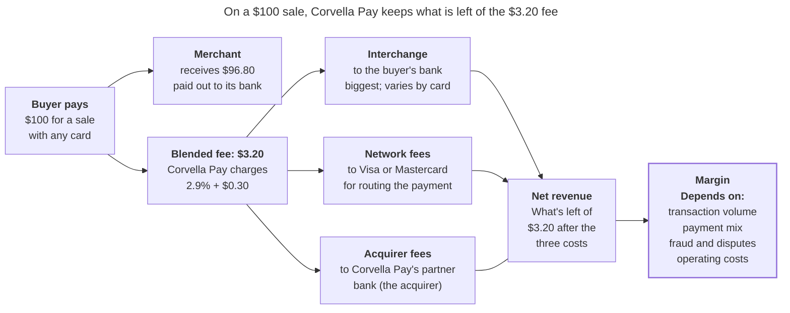
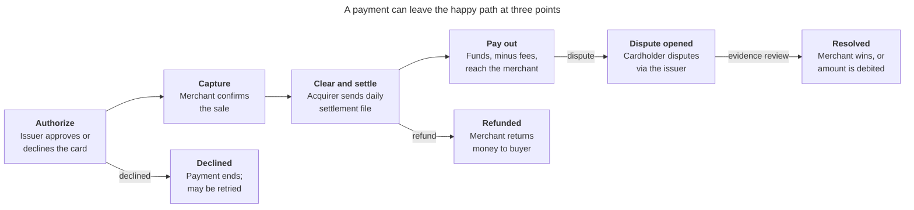
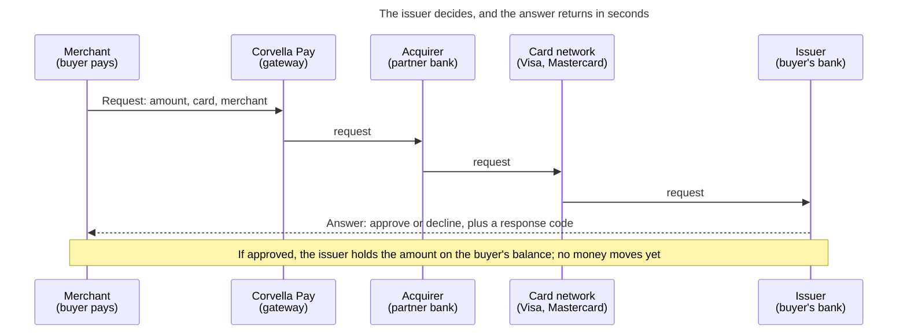

# Corvella Pay — Business Context

## Company

Corvella Pay is a fictional US payment facilitator that lets small and mid-sized merchants accept payments online and in person. You are a Senior Analytics Engineer on its Data Platform team. All company names and figures in this section are invented for the project.

**What it sells.** Corvella Pay helps businesses (its "merchants") get paid by their customers. A business signs up online in a few minutes. It doesn't need to open a special card-acceptance account at a bank, because Corvella Pay handles that bank relationship for it. Corvella Pay offers three things:

- **Online checkout:** the payment step of a website or app, where the buyer types card details and clicks "Pay". A merchant's developers can connect it with code (an API), or the merchant can use a ready-made payment page that Corvella Pay hosts.
- **Point-of-sale (POS) terminals:** the card machines on a shop or restaurant counter, where the buyer taps or inserts a card.
- **Payouts:** Corvella Pay regularly sends the money it collected, minus its fees, to the merchant's bank account.

Buyers can pay with credit or debit cards, with digital wallets (such as Apple Pay or Google Pay, which store a card on the phone), or with ACH bank transfers. **ACH** (Automated Clearing House) is the US network banks use to move money directly from one bank account to another. It's used for payroll, bills and subscriptions. A transfer usually takes one to a few business days.

**How it makes money.** Corvella Pay charges merchants a **blended fee**: 2.9% of the sale plus $0.30, whatever card the buyer uses. A basic debit card usually costs little in interchange, while a premium rewards credit card, a business card or a foreign card costs more. Corvella Pay blends all those different costs into one average price that is easy for a small business to understand. 

The following diagram shows where the money from a $100 card sale goes. The buyer pays $100: the merchant receives $96.80, and Corvella Pay keeps the $3.20 blended fee. Out of that fee, Corvella Pay pays three costs: **interchange** to the buyer's bank (the biggest one), **network fees** to Visa or Mastercard, and fees to its partner bank, the **acquirer**. What's left is its **net revenue**. Its **margin** then depends on how many transactions it processes, which cards the buyers use, how much it loses to fraud and disputes, and what it spends to run the company.

**Scale**

| Metric | Value |
|---|---|
| Active merchants | about 40,000 |
| Annual total payment volume (TPV) | about $12 billion |
| Transactions per year | about 180 million |
| Main merchant segments | e-commerce, subscriptions/SaaS, restaurants, retail |

**The data platform.** Data lands in a Databricks lakehouse governed by Unity Catalog. Main sources: payment gateway events (authorizations, captures, refunds), daily settlement files from the acquiring bank, dispute notifications from the card networks, the merchant onboarding and KYC system, the internal ledger, and the CRM. The Data Platform team owns the shared models that Finance, Risk, Merchant Success and Product use.

## How money moves

Every card payment at Corvella Pay follows the same four steps, and three exits (declined, refund, dispute) from that path create most of the operational work.

Declines happen at authorization, refunds can follow any captured sale, and disputes can arrive weeks or months after the merchant was paid, which makes them late-arriving events in the data.

### The payment lifecycle in depth

The whole lifecycle can be summarized as:

- Information moves in seconds
- Money moves in days
- Disputes can show up months later

That timing gap is why payments data is full of late-arriving events.

#### Who's involved

| Party | Role | Example |
|---|---|---|
| Cardholder | The buyer, who pays with a card | A customer of a coffee shop |
| Merchant | Sells the product and accepts the card | The coffee shop, a Corvella Pay customer |
| Corvella Pay (payment facilitator) | Onboards merchants under its own master account, runs the gateway, and pays merchants out |  |
| Acquirer (acquiring bank) | The bank that sponsors Corvella Pay in the card networks and receives funds on its behalf | A sponsor bank |
| Card network | Routes messages and moves funds between banks, sets the rules (interchange, disputes) | Visa, Mastercard |
| Issuer (issuing bank) | The cardholder's bank, which issued the card and decides whether to approve | The cardholder's bank |

#### The main path

**1. Authorize (seconds).** When the buyer pays, the request travels from the merchant to Corvella Pay's gateway, then to the acquirer, the network, and finally the issuer. The issuer checks whether the card is valid, whether there's enough credit or balance, and whether the transaction looks like fraud. It answers with approve or decline, plus a response code. If approved, the issuer places a hold on the cardholder's available balance. **No money moves yet.** It's a promise that the funds are reserved, and the hold expires if it's never captured.

**2. Capture (seconds to days).** The merchant confirms it wants to collect the authorized amount. Sometimes this happens at the same moment as authorization: a "sale," typical at a store counter. Sometimes it's later: an online shop often captures when the order ships.

The captured amount can differ from the authorized one. A restaurant authorizes the bill, then captures it with the tip added. A shop may capture only part of an order if some items are out of stock. Captures are usually batched and submitted at the end of the day.

**3. Clear and settle (typically 1–2 business days).** These are two steps that usually get described together:

- **Clearing** is the exchange of final transaction details through the network. It is like checking the bill and agreeing on the total amount. The issuer posts the charge to the cardholder's statement, and the network calculates **interchange**, the fee the issuer earns on each transaction.
- **Settlement** is when money actually moves. The issuer pays the network, and the network pays the acquirer the transaction amount minus interchange and network fees. The acquirer credits Corvella Pay's account.

The acquirer then sends a **daily settlement file** listing each transaction with its gross amount, interchange, fees, and net amount. This file is what Finance reconciles against Corvella Pay's own records.

**4. Pay out (on a schedule, e.g. daily).** Corvella Pay pays each merchant through a bank transfer (usually ACH). The payout is a net amount:

> payout = captured sales − refunds − chargebacks − Corvella Pay's fees − reserve held

A **reserve** is a portion of the money Corvella Pay holds back from risky merchants, to cover future refunds or chargebacks it might otherwise have to absorb.

#### The three exits

**Declined (at authorization).** Declines come in two kinds:

- **Soft declines** are temporary, like insufficient funds or the issuer being unavailable. Retrying later can work.
- **Hard declines** are permanent, like an expired card, a closed account, or a card reported stolen. Retrying is useless and can even be penalized by the networks.

Declines can also come from Corvella Pay's own risk engine, which can block a payment before it reaches the issuer.

**Refunded (after capture).** The merchant gives money back voluntarily: full or partial, always referencing the original transaction. The refund travels through clearing as a credit to the cardholder, and Corvella Pay deducts it from the merchant's next payout.

One distinction matters for modeling: before settlement, a merchant can usually **void** the transaction, which simply cancels it. After settlement, it must be a **refund**, which is a new money movement in the opposite direction.

**Dispute opened (after settlement, sometimes much later).** The cardholder contacts their bank, not the merchant, to contest the charge, for example claiming fraud, an item not received, or a cancelled subscription. The issuer files a chargeback through the network with a **reason code**. The money is immediately pulled back from the acquirer, then from Corvella Pay, which debits the merchant, usually with a fee. On a single order, the merchant has the order value at risk plus a dispute fee, commonly $15 to $25, plus 20 to 45 minutes of evidence work ([Redo](https://redo.com/articles/chargebacks/chargeback-statistics)).

Cardholders can dispute long after the purchase; for many reason codes, the window is around 120 days. That's why a dispute is a classic late-arriving event: the merchant may have been paid weeks earlier.

**Resolved (weeks).** The merchant can fight the dispute by submitting evidence before a deadline (called representment): tracking numbers, receipts, proof of service. The issuer decides. If the merchant wins, the money returns. If it loses or doesn't respond in time, the debit stands. The issuer can also escalate to a second cycle, which delays the outcome further.

Two numbers show how hard this is: merchants win about 44.6% of the chargebacks they represent, but net recovery across all chargebacks is just 10.7% ([Chargebacks911 via Redo](https://redo.com/articles/chargebacks/chargeback-statistics)).

Winning a dispute also doesn't make it disappear. Visa watches each merchant's **dispute rate**: the share of its payments that get disputed. Every dispute counts in that rate, even the ones the merchant wins; winning only brings the money back. For example, if 2 out of every 100 payments of a merchant are disputed, its dispute rate is 2%, above Visa's 1.5% limit for merchants with enough volume, even if the merchant wins all of them. Visa also watches the dispute rate of all of Corvella Pay's merchants together. If that combined rate gets too high, the acquirer can penalize Corvella Pay or end the partnership, so Corvella Pay needs to spot merchants with rising dispute rates early.

#### Data produced at each stage

Each stage of the money path produces its own records, from its own source system. The tables below follow one example payment (`pay_8F3K2Q`, a $100 credit card purchase in an online clothing store) through every stage. Column names, types (Spark SQL) and values are invented for the project and are a starting point for the synthetic source data. The full card number is never stored; only the first six digits (the BIN, which identifies the issuer) and the last four.

**1. Authorization event** (gateway, real time)

| Column | Type | Example | Meaning |
|---|---|---|---|
| authorization_id | STRING | auth_7Q2M9X | Unique ID of this authorization attempt |
| payment_id | STRING | pay_8F3K2Q | Links every record of the same payment |
| merchant_id | STRING | mer_00412 | The merchant selling the product |
| event_ts | TIMESTAMP | 2026-10-14 15:32:07 | When the attempt happened |
| amount | DECIMAL(18,2) | 100.00 | Amount requested |
| currency | STRING | USD | Currency of the amount |
| channel | STRING | card_not_present | Online (card not present) or in store (card present) |
| card_brand | STRING | visa | Card network |
| card_type | STRING | credit | credit, debit or prepaid |
| card_bin | STRING | 411111 | First six digits; identify the issuer |
| card_last4 | STRING | 4242 | Last four digits |
| issuer_country | STRING | US | Country of the buyer's bank |
| mcc | STRING | 5651 | Merchant category code (5651 = clothing stores) |
| risk_score | DECIMAL(5,4) | 0.1200 | Corvella Pay's fraud score, 0 to 1 |
| status | STRING | approved | approved or declined |
| response_code | STRING | 00 | Issuer's answer (00 = approved, 51 = insufficient funds) |
| decline_type | STRING | null | soft or hard, only when declined |
| auth_code | STRING | 834201 | Approval code returned by the issuer |

**2. Capture event** (gateway, seconds to days later)

| Column | Type | Example | Meaning |
|---|---|---|---|
| capture_id | STRING | cap_3J8D1L | Unique ID of the capture |
| payment_id | STRING | pay_8F3K2Q | The payment being captured |
| authorization_id | STRING | auth_7Q2M9X | The authorization it collects |
| event_ts | TIMESTAMP | 2026-10-15 09:10:44 | When the merchant confirmed the sale |
| captured_amount | DECIMAL(18,2) | 100.00 | Can differ from the authorized amount |
| capture_type | STRING | full | full or partial |
| batch_id | STRING | bat_20261015_01 | End-of-day batch sent for clearing |

**3. Settlement file line** (acquirer, one row per transaction, 1–2 business days later)

| Column | Type | Example | Meaning |
|---|---|---|---|
| settlement_date | DATE | 2026-10-16 | Day the money moved |
| file_name | STRING | acq_settlement_20261016.csv | Daily file it came from |
| acquirer_reference | STRING | 24692166289000012345678 | Reference number the networks use for this transaction |
| payment_id | STRING | pay_8F3K2Q | Corvella Pay's reference, used to match the line |
| transaction_type | STRING | sale | sale or refund |
| gross_amount | DECIMAL(18,2) | 100.00 | Transaction amount |
| interchange_fee | DECIMAL(18,2) | 2.10 | Paid to the buyer's bank |
| network_fee | DECIMAL(18,2) | 0.14 | Paid to Visa or Mastercard |
| acquirer_fee | DECIMAL(18,2) | 0.20 | Paid to the acquirer |
| net_amount | DECIMAL(18,2) | 97.56 | What Corvella Pay receives for this line |
| currency | STRING | USD | Currency |

**4. Merchant payout** (internal ledger, on the payout schedule)

| Column | Type | Example | Meaning |
|---|---|---|---|
| payout_id | STRING | po_20261017_00412 | Unique ID of the payout |
| merchant_id | STRING | mer_00412 | Merchant being paid |
| payout_date | DATE | 2026-10-17 | Day the transfer was sent |
| gross_sales | DECIMAL(18,2) | 4850.00 | Captured sales included |
| refunds | DECIMAL(18,2) | 40.00 | Refunds deducted |
| chargebacks | DECIMAL(18,2) | 0.00 | Chargebacks deducted |
| corvella_fees | DECIMAL(18,2) | 152.60 | Blended fees on the included sales |
| reserve_held | DECIMAL(18,2) | 242.50 | Amount held back for risk |
| net_payout | DECIMAL(18,2) | 4414.90 | Amount sent to the merchant's bank |
| transfer_method | STRING | ACH | How the money was sent |
| status | STRING | paid | pending, paid or failed |

Each payout also has one line per included transaction or adjustment, so a payment can be traced to the payout that paid it.

**5. Refund or void event** (gateway, after capture)

| Column | Type | Example | Meaning |
|---|---|---|---|
| refund_id | STRING | ref_9M4T6B | Unique ID of the refund |
| payment_id | STRING | pay_8F3K2Q | Original payment |
| event_ts | TIMESTAMP | 2026-10-20 13:45:12 | When the merchant issued it |
| refund_type | STRING | refund | void (before settlement) or refund (after) |
| refund_amount | DECIMAL(18,2) | 40.00 | Can be partial |
| reason | STRING | customer_return | Merchant's stated reason |

**6. Dispute notification** (card network, weeks to months later)

| Column | Type | Example | Meaning |
|---|---|---|---|
| dispute_id | STRING | dsp_K82J1A | Unique ID of the dispute |
| payment_id | STRING | pay_8F3K2Q | Disputed payment |
| acquirer_reference | STRING | 24692166289000012345678 | Used to match the network's notice to the payment |
| received_ts | TIMESTAMP | 2026-12-02 11:05:00 | When the notice arrived |
| dispute_amount | DECIMAL(18,2) | 100.00 | Amount pulled back |
| network | STRING | visa | Network that sent it |
| reason_code | STRING | 13.1 | Network's code for the reason |
| reason_category | STRING | merchandise_not_received | Readable group of the reason |
| stage | STRING | first_chargeback | Stage of the dispute process |
| respond_by | DATE | 2026-12-22 | Deadline to submit evidence |
| dispute_fee | DECIMAL(18,2) | 15.00 | Fee charged to the merchant |

**7. Dispute resolution** (card network, weeks later)

| Column | Type | Example | Meaning |
|---|---|---|---|
| dispute_id | STRING | dsp_K82J1A | Dispute being resolved |
| evidence_submitted_ts | TIMESTAMP | 2026-12-10 16:20:00 | When the merchant sent evidence (null if none) |
| outcome | STRING | won | won or lost |
| resolved_ts | TIMESTAMP | 2027-01-08 10:00:00 | When the issuer decided |
| amount_recovered | DECIMAL(18,2) | 100.00 | Money returned to the merchant |
| final_stage | STRING | first_chargeback | Stage where it ended (or a second cycle) |

#### What this means for the data

Each box produces data at a different time, from a different source:

| Step | When it arrives | Source |
|---|---|---|
| Authorization, decline | Real time | Gateway events |
| Capture, void, refund | Seconds to days | Gateway events |
| Clearing and settlement | 1–2 business days | Acquirer settlement file |
| Payout | Payout schedule | Internal ledger |
| Dispute, resolution | Weeks to months | Network dispute notifications |

This is why payments are such good material for the roadmap. A single payment is a lifecycle with milestones (an accumulating snapshot). Its events arrive late and from separate systems (late-arriving facts). And proving that the gateway, settlement file and ledger agree is reconciliation work.

## Sources

- [Chargeback statistics for 2026, every source named](https://redo.com/articles/chargebacks/chargeback-statistics) — Redo, August 2026 (Nilson Report, LexisNexis, Chargebacks911, Visa VAMP figures)
- [Avoiding false declines](https://www.clear.sale/blog/avoiding-false-declines) — ClearSale
- [86% of payment firms say their data lacks transparency and standardization](https://financialit.net/news/payments/86-payment-firms-say-their-data-lacks-transparency-and-standardization-needed) — FinancialIT, on the AutoRek payments survey
- [Health and fitness companies lose 11% of revenues from failed payments](https://www.pymnts.com/subscriptions/2023/health-fitness-companies-lose-11-percent-revenues-failed-payments/) — PYMNTS and FlexPay, 2023
- [Buy a payment processing business in 2026](https://ctacquisitions.com/?p=43343) — CT Acquisitions, June 2026
