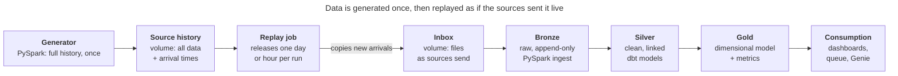

# Corvella Pay — Disputes & Chargebacks Analytics

An end-to-end analytics engineering project on **Databricks** and **dbt**, built around a realistic fintech problem: managing card payment disputes (chargebacks) at a payment facilitator.

Corvella Pay is a fictional US payment facilitator serving about 40,000 small and mid-sized merchants. All company data is synthetic, generated with PySpark to reproduce the behavior of real payment sources: late-arriving disputes, status changes over months, and merchants whose attributes change over time.

## The business problem

Disputes cost Corvella Pay money and put its relationship with its acquiring bank at risk:

- The portfolio dispute rate rose from 0.31% to 0.46% in a year, close to Visa's 0.50% line for an acquirer's portfolio. The acquirer has asked for an action plan.
- About 18% of disputes are lost because the response deadline passes before evidence is submitted.
- Risky merchants are found weeks late, in a monthly spreadsheet.
- Unrecovered dispute losses reached $1.9 million last year.
- Risk, Finance and Disputes Operations each report a different dispute rate.

The root cause is data: dispute information is scattered across systems, arrives late, overwrites its own history and has no single metric definitions.

## What the solution delivers

| Consumer | Delivers | Freshness |
| --- | --- | --- |
| Disputes Operations | Work queue of open disputes, sorted by deadline and amount | Hourly, business hours |
| Risk | Dispute rates per merchant and portfolio, watch list, reserve coverage | Daily |
| Finance and leadership | Dispute losses, open exposure, cohort dispute rates, acquirer report | Daily and month-end |
| Everyone | Governed metrics and a Genie space for plain-language questions | Same as the tables |

## Architecture



- **Medallion architecture** in one Unity Catalog catalog (`corvella`), with schemas `landing`, `bronze`, `silver` and `gold`.
- **Generate once, replay by arrival time:** the full history is generated once, then released into the inbox day by day (or hour by hour), so the pipeline receives data the way it would from real source systems.
- **Bronze** is append-only, loaded incrementally by Auto Loader with an `availableNow` trigger.
- **Silver and gold** are dbt models executed on a Databricks SQL warehouse. Gold is a dimensional model: payment facts, a dispute accumulating snapshot, a type 2 merchant dimension and daily snapshots.
- **Three jobs:** source simulator, ingestion (one task per source) and transformation (dbt), so a failing source never blocks the others.
- **Batch, not streaming:** no decision needs data fresher than one hour.

## Key decisions

| ADR | Decision |
| --- | --- |
| [001](docs/architecture_decision_records/adr-001-medallion-unity-catalog.md) | Medallion architecture on Databricks, governed by Unity Catalog |
| [002](docs/architecture_decision_records/adr-002-generate-once-replay.md) | Generate source data once, replay it by arrival time |
| [003](docs/architecture_decision_records/adr-003-landing-uc-volume.md) | Landing in a Unity Catalog volume |
| [004](docs/architecture_decision_records/adr-004-bronze-append-only.md) | Bronze append-only, loaded by Auto Loader (`availableNow`) |
| [005](docs/architecture_decision_records/adr-005-dbt-silver-gold.md) | Silver and gold built with dbt, executed by Databricks |
| [006](docs/architecture_decision_records/adr-006-batch-processing.md) | Batch processing, no streaming |
| [007](docs/architecture_decision_records/adr-007-merchant-scd2-from-versions.md) | Merchant type 2 history built from preserved versions, not dbt snapshots |

## Tech stack

Databricks Free Edition (serverless compute, Unity Catalog, Jobs, AI/BI dashboards, Genie) · PySpark · dbt Core with dbt-databricks · GitHub Actions

| Tool | Version | Where it is set |
| --- | --- | --- |
| Python | 3.12 (same as Databricks serverless jobs) | `.python-version` |
| dbt Core | 1.12 | Installed with dbt-databricks |
| dbt-databricks | 1.13.0 | `requirements.txt` |

## How to run

Prerequisite: [uv](https://docs.astral.sh/uv/), used to create the Python environment. The project uses Python 3.12, the version Databricks serverless jobs run; uv downloads it if it is missing, without changing the system Python.

1. Create the virtual environment and install dbt (the version is pinned in `requirements.txt`):

    ```bash
    uv venv --python 3.12 .venv
    uv pip install -r requirements.txt
    source .venv/bin/activate
    ```

2. Copy `.env.example` to `.env` and fill in your Databricks workspace host, SQL warehouse HTTP path and personal access token. `.env` is ignored by Git and must never be committed.

    ```bash
    cp .env.example .env
    ```

3. Load the variables into your shell, then run dbt from the `dbt/` folder, where the project and its `profiles.yml` live. dbt does not read `.env` by itself, so the variables must be exported before running any dbt command:

    ```bash
    set -a; source .env; set +a   # export everything in .env
    cd dbt
    dbt deps    # install dbt packages
    dbt debug   # check the connection to the SQL warehouse
    ```

## Project status

Done:

- [x] Business context and requirements
- [x] Solution design and architecture decisions

Next:

- [ ] Smoke test for the dbt task (and Databricks Asset Bundles)
- [ ] Repository, environments (dev and prod) and CI skeleton
- [ ] Source data generation: detailed spec and generator
- [ ] Schema for each layer and the gold dimensional model
- [ ] Semantic layer and metric definitions
- [ ] Ingestion and dbt models, with data quality tests and contracts
- [ ] Governance and security: permissions, masks, row filters
- [ ] Consumption: work queue, Risk dashboard, Genie space
- [ ] Data monitoring
- [ ] Jobs as code and deployment
- [ ] Documentation and portfolio packaging

## Documentation

- [Business context](docs/business_context.md) — company, payment lifecycle, dispute process, business questions, metrics, requirements and constraints.
- [Solution design](docs/solution_design.md) — architecture, layers, source data, Unity Catalog layout, processing and orchestration.
- [Architecture decision records](docs/architecture_decision_records/) — one file per architecture decision (ADR-001 to ADR-007).
