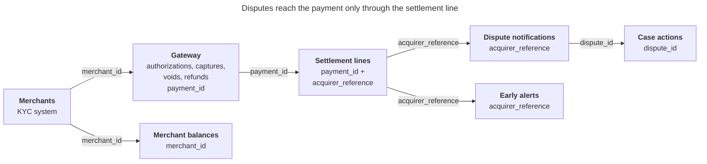

# Corvella Pay Disputes — Source Data Specification

Nov 14, 2026 · Adrieli Dal'Toé

## Purpose and scope

This document specifies the synthetic source data that the PySpark generator produces: which files each source system sends, their columns, when they arrive, and the rules that make the data behave similar to the real process. It is the contract between the generator and the pipeline: the ingestion job and the dbt sources are built against it.

The sources are the ten listed in the [solution design](../../architecture/solution_design.md#source-data), which selected them to answer the 17 business questions in the [business context](../../business_context.md#business-questions). The solution design explains *why* each source exists; this document defines *exactly what* the generator writes.

How the data reaches the pipeline is described in [ADR-002](../../architecture/decisions/adr-002-generate-once-replay.md): the generator writes the full history once, grouped by arrival time, into the `source_history` volume, and the replay job copies it into the `inbox` volume one month, day or hour at a time.

How the generator is built, and its progress, are in the [generator plan](plan.md).

## Conventions

These apply to every source unless its section says otherwise.

| Topic | Rule |
| --- | --- |
| History window | 24 months, from 2024-11-01 to 2026-10-31 (parameters `start_date`, `end_date`). The end date is the simulated "today": nothing arrives after it. |
| Warm-up | Payments start 120 days before the window (from 2024-07-04), so disputes received in the first months link to payments that exist. Warm-up files are released with the first backfill batch. |
| Scale | About 1% of Corvella Pay's volume (parameter `scale`, default 0.01) |
| Reproducibility | A fixed `seed` (default 42). The same parameters always produce identical files. Random values are derived from a hash of the record's key and the seed, not from `rand()`, so the output doesn't depend on how Spark partitions the data. |
| Time zone | All timestamps are UTC, written as ISO 8601 with a `Z` suffix (`2026-08-14T15:32:07Z`). Business days, business hours and the ledger day follow US Eastern time; their UTC values are stored. |
| Business days | Monday to Friday, US Eastern time. Bank holidays are ignored (simplification). |
| Money | Two decimal places, US dollars only. In JSON, amounts are strings (`"100.00"`) so no value passes through a floating-point type; bronze casts them to `DECIMAL(18,2)`. |
| Card data | Only `card_bin` (first six digits) and `card_last4`. The full card number is never generated. |
| Personal data | Names and emails are obviously fake (`cardholder_004812@example.com`) and exist only so column masks can be tested. |
| JSON files | JSON Lines (one object per line), UTF-8. Missing values are `null`, not absent keys. |
| CSV files | UTF-8, comma-separated, header row, `.` as decimal separator, empty field for null. |
| IDs | A prefix plus a code built from a sequence number, so IDs never collide: `pay_8F3K2Q7A1B`, `mer_00412`. Prefixes: `pay_` payment, `auth_` authorization, `cap_` capture, `void_` void, `ref_` refund, `mer_` merchant, `dsp_` dispute, `ntf_` dispute notification, `alr_` alert, `ale_` alert event, `act_` case action, `acm_` account manager, `ops_` Disputes Operations analyst. The capture batch ID is the exception: it is built from the batch date and the merchant (`bat_20260815_00412`). |

## How the sources connect

Two terms from the acquirer's side explain how the sources link:

- **Settlement line:** one row of the acquirer's daily settlement file (Source 5). Every business day, the acquirer lists each transaction whose money moved that day (a sale, a refund or an adjustment) with its gross amount, the fees taken and the net amount. It is the only record that carries both Corvella Pay's `payment_id`, which the gateway sends with the transaction, and the network's `acquirer_reference`.
- **Acquirer reference (`acquirer_reference`):** the 23-digit Acquirer Reference Number (ARN) the acquirer assigns to a transaction when it submits it to Visa or Mastercard for clearing. From then on, the network, the issuer and the cardholder's bank identify the transaction by this number. The example `24692166229000012345678` is a format code (`2`), the acquirer's BIN (`469216`), the clearing date as the last digit of the year and the day of the year (`6229`, Aug 17, 2026), a sequence number and a check digit.



Arrows follow the order of events; labels are the join keys.

Disputes and alerts come from the network side, which knows only the `acquirer_reference`; the gateway never sees it and the networks never see the `payment_id`. That's why disputes and alerts can only be linked to a payment through the settlement lines.

## Files and delivery

| # | Source | Inbox folder | Format | One file per | Arrives |
| --- | --- | --- | --- | --- | --- |
| 1 | Payment gateway | `gateway_authorizations` | JSON Lines | Hour | 5 minutes after the hour it covers |
| 2 | Payment gateway | `gateway_captures` | JSON Lines | Hour | 5 minutes after the hour it covers |
| 3 | Payment gateway | `gateway_voids` | JSON Lines | Hour | 5 minutes after the hour it covers |
| 4 | Payment gateway | `gateway_refunds` | JSON Lines | Hour | 5 minutes after the hour it covers |
| 5 | Acquirer | `settlement_files` | CSV | Business day | 10:00 UTC on the settlement date |
| 6 | Card networks | `dispute_notifications` | JSON Lines | Network batch, 4 per business day | 14:00, 16:00, 18:00 and 20:00 UTC |
| 7 | Card networks | `early_alerts` | JSON Lines | Network batch, 4 per day (every day) | 02:00, 08:00, 14:00 and 20:00 UTC |
| 8 | Case system | `case_actions` | JSON Lines | Hour, 8:00–20:00 US Eastern | 5 minutes after the hour it covers |
| 9 | Know Your Customer system | `merchants` | JSON Lines | Day (only merchants created or changed that day) | 05:00 UTC the next day |
| 10 | Internal ledger | `merchant_balances` | CSV | Day | 06:00 UTC the next day |

**File names** carry the source and the arrival time, so the replay job can release files up to any simulated hour without opening them: `<source>_<YYYYMMDD>T<HH>.<ext>`, for example `gateway_authorizations_20260814T16.json` or `settlement_20260817T10.csv`. The settlement file keeps the acquirer's own name in its `file_name` column.

**Folder layout**, the same in `source_history` and `inbox`:

```
/Volumes/<catalog>/landing/<source_history | inbox>/
    gateway_authorizations/arrival_date=2026-08-14/gateway_authorizations_20260814T16.json
    settlement_files/arrival_date=2026-08-17/settlement_20260817T10.csv
    ...
```

`arrival_date` is the UTC date of arrival. A late file goes in the folder of the day it actually arrives, not the day its data refers to.

## Payment gateway: common rules

The gateway sends four sources, one per event type: authorizations, captures, voids and refunds. Each happens at a different moment of the payment lifecycle and carries different columns, so each has its own files (see the [solution design](../../architecture/solution_design.md#source-data)). The events of one payment share its `payment_id`.

A payment (`payment_id`) has exactly one authorization. A declined payment ends there; a retry by the cardholder is a new payment. An approved payment then has one of these paths:

| Path | Events |
| --- | --- |
| Captured | One capture, then zero or more refunds after it settles |
| Voided before capture | One void, no capture |
| Captured, then voided before the batch is sent | One capture and one void; it never settles |
| Expired | No further event: the hold lapses |

**Rules shared by the four sources**

- **Volume:** about 5,000 payments a day on average, growing 10% a year, with a weekly pattern (online payments dip on weekends, restaurants peak on Friday and Saturday) and a +20% season from mid-November to December.
- **Batches:** captures are grouped into one batch per merchant per day, closed at 23:00 US Eastern and sent for clearing. Until its batch is sent, a capture can still be voided; after that, money can only be given back through a refund.
- **Amounts** are always positive; the event type gives the direction.

## Source 1: Gateway authorizations

One event per authorization attempt, approved or declined. The payment's attributes (card, channel, category, risk score) come from its authorization.

| Column | Type | Null | Example | Meaning |
| --- | --- | --- | --- | --- |
| authorization_id | STRING | no | auth_7Q2M9X4L1C | Unique ID of the authorization attempt |
| payment_id | STRING | no | pay_8F3K2Q7A1B | Links every event of the same payment |
| merchant_id | STRING | no | mer_00412 | The merchant selling |
| event_ts | TIMESTAMP | no | 2026-08-14T15:32:07Z | When the attempt happened |
| amount | DECIMAL(18,2) | no | 100.00 | Amount requested |
| currency | STRING | no | USD | Always `USD` |
| channel | STRING | no | card_not_present | `card_present` or `card_not_present` |
| card_brand | STRING | no | visa | `visa` or `mastercard` |
| card_type | STRING | no | credit | `credit`, `debit` or `prepaid` |
| card_bin | STRING | no | 411111 | First six digits of the card; identify the issuer |
| card_last4 | STRING | no | 4242 | Last four digits |
| issuer_country | STRING | no | US | Country of the buyer's bank |
| mcc | STRING | no | 5651 | Merchant category code at the time of the payment (see the merchant categories seed) |
| risk_score | DECIMAL(5,4) | no | 0.1200 | Corvella Pay's fraud score, 0 to 1 |
| status | STRING | no | approved | `approved` or `declined` |
| response_code | STRING | yes | 00 | Issuer's answer (see generation rules); null when the risk engine blocked the attempt, because it never reached the issuer |
| decline_type | STRING | yes | null | `soft` or `hard`, only when declined |
| decline_source | STRING | yes | null | Who declined: `issuer` or `risk_engine` (Corvella Pay's own risk engine), only when declined |
| auth_code | STRING | yes | 834201 | Six-digit approval code returned by the issuer, only when approved |

**Generation rules**

- **Approval:** 92% approved. Approved authorizations have response code `00`.
- **Risk engine blocks:** Corvella Pay's risk engine blocks every attempt with `risk_score` ≥ 0.85 before it reaches the issuer: `status = declined`, `decline_source = risk_engine`, `decline_type = hard`, and `response_code` and `auth_code` null. The score distribution is set so these are about 5% of declines (0.4% of attempts).
- **Issuer declines:** the other 95% of declines have `decline_source = issuer` and are 60% soft (`51` insufficient funds, `91` issuer unavailable) and 40% hard (`05` do not honor, `14` invalid card, `54` expired card, `43` stolen card).
- **Channel by segment:** e-commerce and subscriptions are card-not-present; restaurants and retail are 90% card-present.
- **Ticket size:** log-normal by segment, with means of about $85 (e-commerce), $35 (subscriptions), $45 (restaurants) and $60 (retail), between $1 and $5,000.
- **Cards:** Visa 65%, Mastercard 35%; credit 55%, debit 40%, prepaid 5%; issuer country US 95%. BINs come from a fixed pool of about 200 fictional BINs (Visa starts with 4, Mastercard with 51–55).
- **Risk score:** mostly low (beta distribution, mean 0.12), and higher on payments that later turn out to be fraud disputes, so the score carries some signal.
- **Expired authorizations:** 0.5% of approved payments are never captured or voided; the hold simply lapses, with no event.

## Source 2: Gateway captures

One event per capture: the merchant confirms it wants to collect the authorized amount.

| Column | Type | Null | Example | Meaning |
| --- | --- | --- | --- | --- |
| capture_id | STRING | no | cap_3J8D1L6R2V | Unique ID of the capture |
| payment_id | STRING | no | pay_8F3K2Q7A1B | The payment being captured |
| authorization_id | STRING | no | auth_7Q2M9X4L1C | The authorization it collects |
| event_ts | TIMESTAMP | no | 2026-08-15T13:10:44Z | When the merchant confirmed the sale |
| captured_amount | DECIMAL(18,2) | no | 100.00 | Can differ from the authorized amount (see generation rules) |
| capture_type | STRING | no | full | `full` or `partial` |
| batch_id | STRING | no | bat_20260815_00412 | End-of-day batch sent for clearing: `bat_`, the batch date (US Eastern) and the merchant number |

**Generation rules**

- **One capture per payment**, at most.
- **Timing by segment:** card-present and subscription payments are captured in the same second as the authorization. E-commerce captures 0 to 5 days later, when the order ships. Restaurants capture within 6 hours.
- **Amount:** e-commerce captures are 3% partial (some items out of stock): `capture_type = partial` and a captured amount 10% to 90% of the authorized one; the rest of the hold is released. Restaurants capture with a tip of 0% to 25% added, so the captured amount can exceed the authorized one; that is still a `full` capture. Every other capture is the authorized amount.

## Source 3: Gateway voids

One event per void: the merchant cancels a payment in full before it settles, so no money moves. A void can happen before capture (the networks call it an authorization reversal) or after capture, as long as the capture's batch has not been sent.

| Column | Type | Null | Example | Meaning |
| --- | --- | --- | --- | --- |
| void_id | STRING | no | void_5C1W8P3K7N | Unique ID of the void |
| payment_id | STRING | no | pay_2H7R5N4M8T | Payment being cancelled |
| authorization_id | STRING | no | auth_4V9K3T2B6Q | The authorization it cancels |
| capture_id | STRING | yes | cap_6N2F7Y1D9R | The capture it cancels; null if voided before capture |
| event_ts | TIMESTAMP | no | 2026-08-15T22:22:31Z | When the merchant voided it |
| void_amount | DECIMAL(18,2) | no | 65.00 | Always the full amount: the captured amount, or the authorized amount if not captured |
| reason | STRING | no | out_of_stock | Merchant's stated reason: `out_of_stock`, `order_cancelled`, `wrong_amount` or `duplicate_charge` |

**Generation rules**

- **Before capture:** 1% of approved e-commerce and restaurant payments (the ones not captured at authorization) are voided between the authorization and the moment the capture would have happened. Reasons: `out_of_stock` or `order_cancelled`.
- **After capture:** 0.5% of card-present payments are voided after capture, the same day and before the 23:00 US Eastern batch close, for example a cashier correcting a wrong amount. Reasons: `wrong_amount` or `duplicate_charge`.
- **No partial voids.** Giving back part of a payment is a refund.
- **Voided payments never settle:** they have no settlement line, are not sales, pay no fees and cannot be disputed.

## Source 4: Gateway refunds

One event per refund: the merchant gives money back on a settled payment, in full or in part.

| Column | Type | Null | Example | Meaning |
| --- | --- | --- | --- | --- |
| refund_id | STRING | no | ref_9M4T6B2H8D | Unique ID of the refund |
| payment_id | STRING | no | pay_8F3K2Q7A1B | Original payment |
| event_ts | TIMESTAMP | no | 2026-08-24T17:45:12Z | When the merchant issued it |
| refund_amount | DECIMAL(18,2) | no | 40.00 | Full or partial |
| reason | STRING | no | customer_return | Merchant's stated reason: `customer_return`, `duplicate_charge`, `service_cancelled`, `goodwill` or `dispute_alert` |

**Generation rules**

- **Only settled payments are refunded.** A refund is a new money movement in the opposite direction, never a cancellation; the fees on the original sale are not returned.
- **Volume and timing:** 3% of settled sales get a refund 1 to 30 days after their settlement date, 30% of them partial.
- **Several refunds per payment:** 10% of partially refunded payments get a second refund 1 to 30 days after the first. A payment's refunds together never exceed its captured amount.
- **Alert refunds:** refunds triggered by an early alert use `reason = dispute_alert` (see Source 7).

## Source 5: Acquirer settlement files

One CSV per business day, with one line per settled sale, refund or adjustment.

| Column | Type | Null | Example | Meaning |
| --- | --- | --- | --- | --- |
| file_name | STRING | no | acq_settlement_20260817.csv | The acquirer's name for the file |
| line_number | INT | no | 1834 | Position of the line in the file |
| settlement_date | DATE | no | 2026-08-17 | Day the money moved |
| acquirer_reference | STRING | no | 24692166229000012345678 | 23-digit reference the networks use for this transaction |
| payment_id | STRING | no | pay_8F3K2Q7A1B | Corvella Pay's payment reference |
| transaction_type | STRING | no | sale | `sale`, `refund` or `adjustment` |
| gross_amount | DECIMAL(18,2) | no | 100.00 | Transaction amount; negative for refunds, 0 for adjustments |
| interchange_fee | DECIMAL(18,2) | no | 2.10 | Paid to the buyer's bank |
| network_fee | DECIMAL(18,2) | no | 0.14 | Paid to the card network |
| acquirer_fee | DECIMAL(18,2) | no | 0.20 | Paid to the acquirer |
| net_amount | DECIMAL(18,2) | no | 97.56 | gross_amount − the three fees |
| currency | STRING | no | USD | Always `USD` |

**Generation rules**

- **Settlement date:** captures are batched at 23:00 US Eastern; a batch settles on the next business day (80%) or the one after (20%). Monday's file therefore holds Friday's, Saturday's and Sunday's batches.
- **Acquirer reference:** one per sale line, unique; refund and adjustment lines carry the reference of the sale they belong to.
- **Fees on sales:** interchange of 2.00% + $0.10 for credit, 0.80% + $0.15 for debit, 1.50% + $0.15 for prepaid; network fee 0.14%; acquirer fee 0.20%. Each fee is rounded to the cent, half up.
- **Refund lines:** the settled refund amount as a negative `gross_amount`, with zero fees. Voided payments never reach settlement, including those voided after capture.
- **Adjustments:** about 0.05% of sales get an adjustment line in a later file (1 to 10 business days later): `gross_amount` 0 and a fee correction of a few cents, positive or negative.

## Source 6: Dispute notifications

One event per notice a network sends about a dispute. The notices of one dispute share its `dispute_id`; replaying them in order gives the dispute's status history from the network's side.

| Column | Type | Null | Example | Meaning |
| --- | --- | --- | --- | --- |
| notification_id | STRING | no | ntf_2H7K9P4Q1M | Unique ID of the notice |
| dispute_id | STRING | no | dsp_K82J1A6T3W | Same for every notice of the dispute, across rounds |
| acquirer_reference | STRING | no | 24692166229000012345678 | The disputed transaction, as the network knows it |
| network | STRING | no | visa | `visa` or `mastercard` |
| notification_type | STRING | no | chargeback_opened | `chargeback_opened`, `pre_arbitration_opened`, `arbitration_opened`, `dispute_won` or `dispute_lost` |
| reason_code | STRING | opened only | 13.1 | Network's reason code (see the reason code seed) |
| amount | DECIMAL(18,2) | no | 100.00 | Disputed amount on `*_opened`; amount returned to the merchant on `dispute_won`; 0 on `dispute_lost` |
| respond_by | DATE | opened only | 2026-10-21 | Deadline to respond to this round |
| received_ts | TIMESTAMP | no | 2026-09-21T14:00:00Z | When the notice arrived (the batch time) |
| cardholder_name | STRING | yes | Cardholder 004812 | Only on `chargeback_opened`; personal data |
| cardholder_email | STRING | yes | cardholder_004812@example.com | Only on `chargeback_opened`; personal data |

The network sends no notice when a dispute is accepted or expires. Those outcomes come from the case actions and the deadline: a dispute is **accepted** when a `merchant_accepted` or `auto_accepted` action exists, and **expired** when `respond_by` passes without an `evidence_submitted` action for that round.

**Linking a dispute to its payment.** Match the dispute's `acquirer_reference` against settlement lines with `transaction_type = sale` only. Refund and adjustment lines carry the same `acquirer_reference` as the sale they belong to, so matching against every line would return several rows for a refunded or adjusted payment and duplicate the dispute. Among sale lines, the `acquirer_reference` is unique, so each dispute matches at most one sale; that sale's `payment_id` leads to the payment and its merchant. Early alerts link the same way.

**Generation rules**

- **Which sales are disputed:** each settled sale has a dispute probability built from its merchant's segment (subscriptions highest, restaurants and retail lowest), its risk tier, a per-merchant factor, and a portfolio trend calibrated to the targets below. A payment has at most one dispute, and a fully refunded payment is never disputed.
- **When:** the chargeback arrives 1 to 120 days after the sale: about 60% within 30 days, 85% within 60 days, the rest up to 120. Notices only arrive on business days.
- **Amount:** the full sale amount in 92% of disputes, part of it in 8% (mostly `processing_error`).
- **Reason category by segment:** e-commerce mostly `fraud` and `merchandise_not_received`; subscriptions mostly `subscription_cancelled`; restaurants and retail mostly `processing_error` and `fraud`. The reason code is then picked from the network's codes for that category.
- **Deadline:** `respond_by` is the received date + 30 days, for every round.
- **First round outcomes**, as shares of disputes received:

  | Outcome | Share | Rule |
  | --- | --- | --- |
  | Auto-accepted | about 12% | Every dispute under the auto-accept limit ($25), on the day it arrives |
  | Accepted by the merchant | about 13% | Merchant decides 2 to 15 days after being notified |
  | Expired | about 18% | No evidence submitted by `respond_by` (see Source 8 for where they stall) |
  | Fought | about 57% | `dispute_won` or `dispute_lost` arrives 20 to 45 days after the evidence is submitted |

- **Win rate of fought disputes:** about 45% overall, varying by reason category: `processing_error` 60%, `merchandise_not_received` 55%, `not_as_described` 40%, `subscription_cancelled` 35%, `fraud` 30%.
- **Second round (pre-arbitration):** 15% of won disputes get a `pre_arbitration_opened` 10 to 30 days after the win, with a new `respond_by`. The merchant accepts 40% of them and fights the rest, winning half. The [steps of a dispute](../../business_context.md#steps-of-a-dispute) explain pre-arbitration and arbitration.
- **Third round (arbitration):** the merchant escalates 3% of lost pre-arbitrations to the network, mostly the largest amounts, because the loser pays a high fee. `arbitration_opened` arrives 5 to 15 days after the `dispute_lost`, with a new `respond_by`. The merchant has already chosen to fight, so this round is never accepted and never expires. The network's ruling, `dispute_won` or `dispute_lost`, arrives 30 to 60 days after the evidence is submitted, and the merchant wins half. The arbitration fee is not in the data.

## Source 7: Early alerts

Alerts the networks send before a chargeback, giving the merchant a chance to refund first. One row per alert event.

| Column | Type | Null | Example | Meaning |
| --- | --- | --- | --- | --- |
| alert_event_id | STRING | no | ale_7C2N5R8V4J | Unique ID of the alert event |
| alert_id | STRING | no | alr_3T6W1K9H2P | Same for every event of the alert |
| acquirer_reference | STRING | no | 24692166229000012345678 | The transaction the cardholder is unhappy with |
| network | STRING | no | visa | `visa` or `mastercard` |
| alert_type | STRING | no | alert_received | `alert_received`, `alert_refunded` or `alert_expired` |
| amount | DECIMAL(18,2) | no | 100.00 | Amount the cardholder is contesting |
| alert_ts | TIMESTAMP | no | 2026-09-03T08:00:00Z | When the event arrived (the batch time) |

**Generation rules**

- **Volume:** about 4 alerts a day, on sales 1 to 60 days old.
- **Refunded (60%):** the merchant refunds within 24 to 72 hours. The gateway sends a refund with `reason = dispute_alert` (Source 4), the network sends `alert_refunded`, and no chargeback follows.
- **Expired (40%):** `alert_expired` 72 hours after the alert. 80% of expired alerts become a chargeback 3 to 20 days later, with the same `acquirer_reference`.

## Source 8: Case actions

Corvella Pay's own record of how each dispute was handled. When a chargeback notice arrives, the Disputes Operations case system opens a case. From then on it logs every step taken on the case: notifying the merchant, receiving their evidence, submitting it to the network, or accepting the dispute. The network only reports when a dispute opens and whether it was won or lost. These actions fill in what happened in between, and they are the only source for disputes that were accepted or that expired.

The export has one row per action. Each dispute has one case, and the actions of every round belong to that case.

| Column | Type | Null | Example | Meaning |
| --- | --- | --- | --- | --- |
| action_id | STRING | no | act_9D4F7L2S6B | Unique ID of the action |
| dispute_id | STRING | no | dsp_K82J1A6T3W | The dispute the case belongs to |
| stage | STRING | no | first_chargeback | Round the action belongs to: `first_chargeback`, `pre_arbitration` or `arbitration` |
| action_type | STRING | no | merchant_notified | `case_opened`, `merchant_notified`, `evidence_received`, `evidence_submitted`, `merchant_accepted` or `auto_accepted` |
| action_ts | TIMESTAMP | no | 2026-09-22T13:40:00Z | When the action was taken |
| actor | STRING | no | ops_007 | An analyst (`ops_001` to `ops_012`), `merchant` or `system` |

**Generation rules**

- **Case opened:** by `system`, within 1 hour of the chargeback notice arriving. Disputes under $25 also get `auto_accepted` at the same time, and nothing else.
- **Merchant notified:** by an analyst, 0 to 3 business days after opening (median 1), with a 5% tail of up to 10 days when the queue is backed up.
- **Evidence received:** from the merchant, for disputes the merchant fights: 3 to 25 days after notification, 20% of them after the internal 20-day limit.
- **Evidence submitted:** by an analyst, 1 to 5 business days after the evidence arrives, and only if that is on or before `respond_by`.
- **Accepted:** `merchant_accepted` by `merchant`, 2 to 15 days after notification.
- **Arbitration:** the merchant asked for it, so the case gets a single `evidence_submitted` with `stage = arbitration`. The analyst submits it 1 to 5 business days after `arbitration_opened`, always on or before `respond_by`, reusing the evidence from the earlier rounds.
- **Where expired disputes stall:** 55% were notified but no evidence ever arrived, 30% had evidence arrive too late to submit, and 15% were never notified at all. That's what question 3 measures.
- **Working hours:** analyst and merchant actions happen between 8:00 and 20:00 US Eastern on business days; `system` actions happen at any time.

## Source 9: Merchants (Know Your Customer system)

A daily change extract: one row for each merchant created or changed that day, with all of its current attributes. A merchant changed twice in one day appears twice, each row with its own `updated_at`.

| Column | Type | Null | Example | Meaning |
| --- | --- | --- | --- | --- |
| merchant_id | STRING | no | mer_00412 | Unique ID of the merchant |
| legal_name | STRING | no | Northwind Apparel LLC | Registered business name |
| mcc | STRING | no | 5651 | Merchant category code (see the merchant categories seed) |
| segment | STRING | no | ecommerce | `ecommerce`, `subscriptions`, `restaurants` or `retail` |
| risk_tier | STRING | no | medium | `low`, `medium` or `high` |
| reserve_rate | DECIMAL(5,4) | no | 0.0500 | Share of sales held in reserve |
| status | STRING | no | active | `active`, `suspended` or `closed` |
| account_manager_id | STRING | no | acm_014 | Merchant Success manager (drives row filters) |
| contact_email | STRING | no | owner_00412@example.com | Personal data |
| onboarding_date | DATE | no | 2025-03-02 | Day the merchant went live |
| updated_at | TIMESTAMP | no | 2026-08-10T15:00:00Z | When this version took effect (the business change time) |

**Generation rules**

- **Portfolio:** about 300 active merchants at the start of the warm-up and about 400 at the end of the window. About 1 merchant is onboarded per day (the business context's 100 a day at 1% scale) and about 0.9 close per day, so the history has roughly 1,150 merchants in total. Segment mix by merchant: e-commerce 40%, subscriptions 20%, restaurants 20%, retail 20%. Merchant size (share of payments) is skewed: the largest 10% of merchants process about half the volume.
- **Risk tier and reserve:** low (reserve 0%), medium (5%) or high (10%). New merchants start at medium in most cases.
- **Changes (type 2):** Risk reviews tiers weekly, on Mondays: each week about 1% of merchants move one tier up or down, and the reserve rate follows the tier. Segment and MCC change rarely (about 5 merchants over the whole history). Status moves to `suspended` or `closed` as described in "Behaviors" below.
- **Corrections (type 1):** about 10 legal names get a typo fixed during the history, with no other attribute changing.
- **Late-arriving dimension:** a new merchant's first payments happen on its onboarding date, but its record only arrives in the next morning's extract.
- **Backdated changes:** 2% of changes appear in an extract 1 to 3 days after their `updated_at`.

## Source 10: Merchant balances (internal ledger)

End-of-day balance per merchant, for every merchant that is active or still has money held.

| Column | Type | Null | Example | Meaning |
| --- | --- | --- | --- | --- |
| balance_date | DATE | no | 2026-09-21 | Ledger day (US Eastern) |
| merchant_id | STRING | no | mer_00412 | The merchant |
| available_balance | DECIMAL(18,2) | no | 1240.18 | Money owed to the merchant and not yet paid out; negative when debits exceed credits |
| reserve_balance | DECIMAL(18,2) | no | 7310.50 | Money held back as reserve |
| written_off_amount | DECIMAL(18,2) | no | 0.00 | Loss Corvella Pay absorbed that day because the balance and reserve didn't cover the debits |

**Generation rules.** The generator keeps a simple ledger per merchant and day:

- **Credits:** settled sales minus Corvella Pay's fees (2.9% + $0.30 card-not-present, 2.6% + $0.10 card-present), and amounts recovered on won disputes.
- **Debits:** refunds; on each chargeback, the disputed amount plus the dispute fee from the policy seed.
- **Payouts:** each business day, a positive available balance is paid out, minus the reserve contribution (the reserve rate times that day's settled sales). Payouts are not a source file; they only move the balance.
- **Reserve release:** reserve contributions are released into the available balance after 90 days.
- **Losses:** when a merchant's available balance is negative and it is suspended or closed, the reserve covers it first. Any remainder is written off that day in `written_off_amount`, and the available balance goes back to 0.

## Behaviors the generator must build in

These carry the business problems into the data, so the pipeline and the dashboards have something real to show.

| Behavior | How it appears | Target |
| --- | --- | --- |
| Rising dispute rate | The portfolio trend factor in Source 6 | Monitoring dispute rate (M1) about 0.31% through October 2025, rising steadily to about 0.46% by October 2026 |
| Merchants drifting toward the limits | About 5% of merchants get a dispute factor that grows over 60 to 120 days. They are picked among merchants with at least 200 settled sales per 30 days, so they are not labeled low volume (M3) and show up in M5. Risk reacts late: their tier goes up 30 to 60 days after they reach 0.75%, and a third of them end up suspended and then closed. | At the end of the window, about 10 merchants in the M5 watch band (0.75% ≤ M3 < 1.5%); 3 merchants reaching the band above Visa's limit (M3 ≥ 1.5%) in the last quarter |
| Unrecovered losses | Closed merchants keep receiving disputes on their past sales for up to 120 days, which their reserve doesn't fully cover | Written-off amount of about $19,000 over the last 12 months |
| Missed deadlines | The case action timing in Source 8 | Expiry rate (M6) about 18% of closed disputes |
| Late arrivals | Disputes 1 to 120 days after the sale; 0.5% of the hourly files of each gateway source arrive 1 to 48 hours late; 2% of settlement files arrive one business day late; 1% of case action files arrive the next morning; 2% of merchant changes are backdated | As listed |
| Status changes over months | Second rounds and arbitration in Source 6; tier and status changes in Source 9 | As listed |

## Data quality traps

Deliberate defects, so the dbt tests and the matching logic have something to catch. Each one is rare enough not to distort the metrics.

| Trap | Source | Rate | What should catch it |
| --- | --- | --- | --- |
| Duplicate events, resent in a later file with the same ID | Gateway (all four sources), dispute notifications | 0.1% of gateway events, 0.5% of notifications | Deduplication on each source's ID in silver |
| Disputes whose `acquirer_reference` matches no settlement line | Dispute notifications | 0.3% of disputes | The unmatched-disputes list (99.5% link target) |
| Settlement adjustments | Settlement files | 0.05% of sales | Settlement models that treat them as corrections, not sales |
| Late settlement file | Settlement files | 2% of business days | Freshness check; dispute rates marked preliminary |
| Payments before their merchant exists | Gateway, merchants | Every new merchant's first day | The unknown-merchant row in `dim_merchant` |

## Reference data

Reason codes, merchant categories and policy thresholds are **dbt seeds**, not generated files (see the solution design). The generator reads the same seed files from `dbt/seeds/`, so both always use the same codes and limits.

| Seed | Columns | Content |
| --- | --- | --- |
| `reason_codes` | network, reason_code, reason_category, description, valid_from, valid_to | About 10 codes per network across the five categories (`fraud`, `merchandise_not_received`, `not_as_described`, `subscription_cancelled`, `processing_error`) |
| `merchant_categories` | mcc, description, segment | The MCCs the generator uses, about 5 per segment |
| `policy_thresholds` | threshold_name, value, valid_from, valid_to | `watch_line` 0.0075, `network_merchant_limit` 0.0150, `acquirer_portfolio_line` 0.0050, `auto_accept_limit` 25.00, `dispute_fee` 15.00 |

## Volumes

At 1% scale, over the 24-month window (the warm-up adds about 15% to the payment sources):

| Source | Per day | Over 24 months |
| --- | --- | --- |
| Gateway authorizations | about 5,000 | about 3.65 million |
| Gateway captures | about 4,530 | about 3.3 million |
| Gateway voids | about 50 | about 35,000 |
| Gateway refunds | about 140 | about 100,000 |
| Settlement lines | about 6,600 per file | about 3.4 million |
| Dispute notifications | 14 to 21 new disputes, about 25 notices | about 19,000 notices (about 12,500 disputes) |
| Early alerts | about 4 alerts, 8 events | about 6,000 events |
| Case actions | about 50 | about 40,000 |
| Merchants | a few changed rows | about 2,400 rows (about 1,150 merchants) |
| Merchant balances | about 450 (active merchants, plus closed ones whose reserve is still held) | about 330,000 |

In total, about 11 million rows, in line with the solution design's estimate of 12 million rows and 1 GB in Delta.

## Questions each source answers

A check that the spec covers the business questions:

| Source | Business questions |
| --- | --- |
| Dispute notifications | 1, 3, 5–7, 9–13, 15–17 |
| Case actions | 1–4, 9, 13, 17 |
| Settlement lines (sales and the link to disputes) | 5–7, 9, 11, 12, 15, 16 |
| Gateway authorizations (payment attributes) | 12 |
| Gateway refunds (refunds after alerts) | 14 |
| Gateway captures and voids | None directly: they complete each payment's lifecycle |
| Early alerts | 14 |
| Merchants | 5–8, 12, 15, 16 |
| Merchant balances | 8, 9 |

## Acceptance checks

The generator's tests confirm, on the generated history:

- Every ID column is unique where the spec says so, and every reference resolves, except the deliberate traps.
- No full card numbers exist, and every amount has at most two decimals.
- A risk engine block has no response code and no approval code; every other authorization has a response code.
- Every payment follows one of the gateway paths: one authorization; at most one capture; voids only for the full amount and never after the capture's batch was sent; voided payments have no settlement line; refunds only after settlement, never more in total than the captured amount.
- Every file sits in the folder of its arrival date, and nothing arrives after `end_date`.
- M1 by month, M6, the number of merchants in the M5 watch band and the written-off amount fall within ±10% of the targets above.
- Running the generator twice with the same parameters produces identical files.
