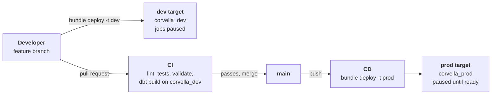

# Environments and CI/CD

Code reaches production in one way only: a feature branch, a pull request that passes CI, and a merge to `main` that CD deploys to the `prod` bundle target. Developers deploy to `dev` from their own machines; automation never deploys on pull requests. The decisions behind this are [ADR-008](architecture_decision_records/adr-008-jobs-as-code-asset-bundles.md) (jobs as code with Databricks Asset Bundles), [ADR-009](architecture_decision_records/adr-009-catalog-per-environment.md) (one catalog per environment).



## Environments

| | dev | prod |
| --- | --- | --- |
| Bundle target | `dev`, development mode | `prod`, production mode |
| Catalog | `corvella_dev` | `corvella_prod` |
| Schemas | `landing`, `bronze`, `silver`, `gold` | Same |
| Deployed by | Each developer, from their machine (`databricks bundle deploy -t dev`) | CD only, on merge to `main` |
| Job names | Prefixed with `[dev <user>]` | As defined |
| Schedules | Paused (development mode) | Paused with the `trigger_pause_status: PAUSED` preset until the pipeline is ready |
| Jobs run as | The developer | Service principal `corvella-deployer` |

**Configuration.** Everything that differs between environments is a bundle variable set per target:

- `catalog`: `corvella_dev` or `corvella_prod`. It is passed to every job, to the dbt task (`catalog: ${var.catalog}`) and to the catalog resources.
- `warehouse_id`: found by name with a `lookup`, as today.

**Data structure as code.** `resources/catalog.yml` defines the catalog, its four schemas and the landing volumes (`source_history`, `inbox`, `_checkpoints`) with `${var.catalog}`, so deploying a target creates its data structure. If the catalog resource type misbehaves in Free Edition, the two catalogs are created once with SQL and only schemas and volumes stay in the bundle.

**dbt locally.** `profiles.yml` keeps a single output whose catalog comes from `env_var('DBT_CATALOG', 'corvella_dev')`. There is no prod output: only prod jobs write to `corvella_prod`. Jobs don't use `profiles.yml`; the dbt task builds its profile from the warehouse and the catalog it is given.

**Turning prod schedules on.** A pull request removes the `presets` line from the `prod` target. After the merge, CD deploys and each job follows its own schedule. A job unpaused by hand in the UI is paused again by the next deploy, so the bundle stays the single source of truth.

## Identities and secrets

Developers use their own identity; automation never uses a personal token. CI doesn't deploy, but it still logs in to Databricks to validate the bundle and to run `dbt build`, which writes tables, so it gets its own service principal with access to `corvella_dev` only. That keeps pull request code away from production credentials:

| Identity | Used by | Logs in with | Access |
| --- | --- | --- | --- |
| Each developer | Local work: `bundle deploy -t dev`, `bundle run`, dbt | Their own user (token in `.env`) | Use the SQL warehouse; read and write `corvella_dev` |
| `corvella-ci` (service principal) | CI, on pull requests: `bundle validate`, `dbt build` | OAuth client ID and secret | Use the SQL warehouse; read and write `corvella_dev` |
| `corvella-deployer` (service principal) | CD, on merge to `main`; `run_as` of prod jobs | OAuth client ID and secret | Use the SQL warehouse; create the `corvella_prod` catalog; read and write it |

Each logs in with OAuth (a client ID and secret), which issues short-lived tokens automatically. Catalog and schema access is granted in the bundle (`grants` on the catalog resources), so permissions are reviewed like code; warehouse access and the right to create catalogs are set once by an admin.

| GitHub secret | Scope | Value |
| --- | --- | --- |
| `DATABRICKS_HOST` | Repository | Workspace URL |
| `DATABRICKS_HTTP_PATH` | Repository | SQL warehouse HTTP path, for `dbt build` in CI |
| `DATABRICKS_CLIENT_ID`, `DATABRICKS_CLIENT_SECRET` | Repository | `corvella-ci` credentials |
| `DATABRICKS_CLIENT_ID`, `DATABRICKS_CLIENT_SECRET` | GitHub environment `prod`, restricted to `main` | `corvella-deployer` credentials; only the CD workflow can read them, and they override the repository values of the same name |

## CI: on every pull request

Steps run from cheapest to most expensive; each runs only if the previous one passed.

| # | Step | Runs when |
| --- | --- | --- |
| 1 | `ruff check` and `ruff format --check` | Always |
| 2 | `pytest` | Always |
| 3 | `databricks bundle validate -t dev` and `-t prod` | The pull request comes from this repository (forks get no secrets) |
| 4 | `dbt deps` and `dbt build` against `corvella_dev` | Same, and the pull request changes `dbt/` |

CI does not deploy. dbt runs with the `corvella-ci` identity and writes to `corvella_dev`, the same catalog developers use (see ADR-009). The Databricks CLI is installed with the `databricks/setup-cli` action, pinned to the same version as locally.

## CD: on merge to `main`

1. `databricks bundle validate -t prod`
2. `databricks bundle deploy -t prod`

The workflow runs in the GitHub environment `prod`, as `corvella-deployer`, with a `concurrency` group so two merges never deploy at the same time. The first deploy creates `corvella_prod`, its schemas and volumes, and the jobs, all paused.

## Repository rules

- `main` is protected: changes go in only through pull requests, CI must pass, and force pushes are blocked. Required approvals are 0, because GitHub doesn't let authors approve their own pull requests.
- No long-lived `dev` branch: environments are bundle targets, not branches. Feature branches merge straight into `main`.
- `.env` holds local connection values and is never committed; `.env.example` lists every variable with placeholders. `profiles.yml` only reads `env_var()`.

## Folder structure

```
.
├── databricks.yml               # bundle: variables, targets (dev, prod)
├── resources/                   # bundle resources, one file per concern
│   ├── catalog.yml              #   catalog, schemas, volumes
│   ├── source_simulator.job.yml
│   ├── ingestion.job.yml
│   └── transformation.job.yml
├── src/corvella/                # Python package, used by jobs and tests
│   ├── generator/               #   PySpark source data generator
│   ├── simulator/               #   replay into the inbox
│   └── ingestion/               #   generic Auto Loader loader and per-source config
├── dbt/                         # dbt project
├── tests/                       # pytest unit tests for src/
├── .github/workflows/
│   ├── ci.yml                   # on pull request
│   └── cd.yml                   # on push to main
├── docs/
├── pyproject.toml               # Python dependencies, ruff and pytest settings
└── .env.example, .gitignore, .python-version, README.md, CLAUDE.md
```

`pyproject.toml` replaces `requirements.txt`. The reference export of the first smoke test job moves from `databricks/jobs/` to `docs/reference/`, so no top-level `databricks/` folder sits next to `databricks.yml`.

## Implementation steps

Each step ends with a check that proves it works.

1. **Repository layout.** `pyproject.toml` (dependencies, ruff and pytest settings), an empty `src/corvella/` package, `tests/` with one test, the reference job moved to `docs/reference/`. *Check:* `ruff check` and `pytest` pass locally.
2. **Service principals.** Create `corvella-ci` and `corvella-deployer` with OAuth secrets, let both use the SQL warehouse, allow `corvella-deployer` to create catalogs, and add the GitHub secrets and the `prod` environment. *Check:* the CLI logs in as each one.
3. **Bundle environments.** `catalog` variable, `dev` and `prod` targets (prod in production mode, paused preset, `run_as` `corvella-deployer`), `resources/catalog.yml` with the grants from the identities table, the smoke test job on `${var.catalog}`. *Check:* `bundle validate -t prod` shows paused jobs run as the deployer; `bundle deploy -t dev` creates `corvella_dev` with its schemas, volumes and grants; the smoke test job runs in dev.
4. **dbt.** `profiles.yml` catalog from `DBT_CATALOG`, `.env.example` updated. *Check:* `dbt build` locally against `corvella_dev`.
5. **CI workflow.** `.github/workflows/ci.yml`. *Check:* a test pull request runs all four steps green, as `corvella-ci`.
6. **CD workflow.** `.github/workflows/cd.yml`. *Check:* the first merge creates `corvella_prod` and the prod jobs, paused, run as `corvella-deployer`.
7. **Branch protection.** Protect `main` and require the CI checks. *Check:* a direct push to `main` is rejected.
8. **Clean up.** Destroy the old dev smoke test deployment, drop the `corvella` catalog, update the README (How to run, status). *Check:* only `corvella_dev` and `corvella_prod` remain.
