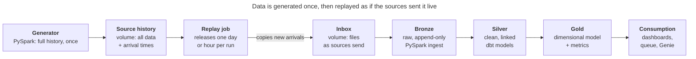

# Corvella Pay Disputes — Solution Design

Nov 4, 2026 · Adrieli Dal'Toé

## Purpose and scope

This document describes how the disputes solution for Corvella Pay is built: the data architecture, where each layer lives, which tool processes it, and why each main decision was made. The architecture design was based on the business context and requirements presented in the [business context document](business_context.md).

The decisions are recorded as architecture decision records (ADRs): short entries with the decision, its context, the alternatives considered and the consequences. When a decision changes, a new record replaces the old one instead of rewriting history.

## Architecture overview

The solution follows a medallion architecture on Databricks, with every layer governed by Unity Catalog. Source data is generated once by a PySpark generator, then released into an inbox day by day (or hour by hour) by a replay job, so the pipeline receives data the way it would from real source systems.



## Layers and responsibilities

| Layer | What it holds | Load pattern | Built with |
| --- | --- | --- | --- |
| **Source history** | The full generated history of every source, each record with the time it would have arrived | Written once | PySpark generator |
| **Inbox (landing)** | Files exactly as the source systems would send them: JSON events from the gateway, networks and case system; one CSV settlement file per day; merchant extracts. Organized by source and arrival date. | One day or hour added per replay run | Replay job (PySpark) |
| **Bronze** | Raw data loaded as-is, plus load metadata (source file name, load time). Never updated or deleted. | Incremental, append-only: each run loads only new files | PySpark with Auto Loader (or COPY INTO) |
| **Silver** | Cleaned, typed and deduplicated data; disputes linked to their original payments; the dispute status history; case action events | Incremental for facts and history (payments, disputes); full rebuild only for small reference tables, following the load-pattern rule below | dbt staging and intermediate models |
| **Gold** | The dimensional model: merchant dimension (type 2), reason code and date dimensions; payment facts; dispute accumulating snapshot; daily snapshots of the open queue and of merchant balances; metric definitions | Same as silver | dbt marts and semantic layer or metric views |
| **Consumption** | Work queue, dashboards, Genie space, SQL access | Read-only | Databricks AI/BI |

Each layer has one job. Bronze keeps what the sources said, unchanged, so any later layer can be rebuilt from it. Silver applies the business rules for cleaning and linking. Gold shapes the data for the questions and metrics in the business context.

**Load patterns, defined:**

- **Full rebuild:** every run reads all the rows of the model's inputs and replaces the whole target table (in dbt, the `table` materialization, which runs `CREATE OR REPLACE TABLE`).
- **Incremental load:** every run reads only the input rows that are new or changed since the last run, using a watermark such as the ingestion timestamp, and writes only those to the target. Rows that never change are appended; rows that change over time are upserted with `MERGE` on their key (in dbt, the `incremental` materialization).

**Load-pattern rule for silver and gold models.** A model is fully rebuilt only when, at Corvella Pay's full scale, it holds fewer than **1 million rows** over its 7-year retention; every other model is loaded incrementally. The rule uses full-scale volumes, not the project's 1% sample, so the design stays valid in production.

With the volumes from the business context:

| Model | Rows at full scale over 7 years | Load pattern | What runs in Databricks | Why |
| --- | --- | --- | --- | --- |
| Payments | About 1.3 billion | Incremental, append | `INSERT INTO` with only the new events, deduplicated on the event ID (dbt incremental, `append`) | Payment events never change; only new ones arrive, so writing just the new rows is the cheapest option |
| Disputes (accumulating snapshot) | About 5.8 million | Incremental, `MERGE` on the dispute ID for every dispute with a new event since the last run | `MERGE INTO … ON dispute_id` (dbt incremental, `merge`) | The disputes that change are scattered across months, so no date range captures them; matching on the key is the natural fit, and the table is small enough that Delta's file rewrites stay cheap |
| Dispute status history and case actions | Several times the number of disputes | Incremental, append | `INSERT INTO` with only the new events, deduplicated on the event ID (dbt incremental, `append`) | Each status change or action is a new row that is never updated |
| Daily snapshots (open queue, balances) | One set of rows per day | Incremental, replace one day per run | `INSERT INTO … REPLACE WHERE snapshot_date = <run date>` (dbt incremental, `replace_where`) | Rerunning a day replaces that day instead of duplicating it, so reruns are safe (idempotent) and the day matches the source exactly |
| Merchant versions (silver, `stg_merchants__versions`) | About 0.8 million (40,000 merchants plus their changes) | Full rebuild from the merchant extracts in bronze | `CREATE OR REPLACE TABLE … AS SELECT` that keeps a row only when a tracked attribute (risk tier, segment, category, reserve rate, status) differs from the merchant's previous version, using `LAG()` (dbt `table`) | Bronze keeps every extract it receives, so the versions can be recalculated exactly at any time; repeated rows for unchanged merchants are collapsed into real changes. Assumption about the source: the onboarding system sends a change extract each day (only merchants created or changed that day), which keeps bronze near 0.8 million rows. If it sent a full extract of all merchants every day instead, bronze would hold about 100 million merchant rows over 7 years, and this model would have to become incremental, processing only the newest extract. |
| Merchant dimension (gold, `dim_merchant`, type 2) | About 0.8 million | Full rebuild from the silver versions | `CREATE OR REPLACE TABLE … AS SELECT` with `LEAD()` over each merchant's versions to set `valid_from`, `valid_to` and `is_current`, plus a surrogate key and an unknown-merchant row (dbt `table`) | The full history can be rebuilt from scratch at any time, which dbt snapshots can't do; `valid_from` is the business change time, not the run time (see [ADR-007](architecture_decision_records/adr-007-merchant-scd2-from-versions.md)) |
| Reference data (reason codes, categories, thresholds) | Hundreds | Full rebuild | `CREATE OR REPLACE TABLE … AS SELECT` (dbt `table`) | A few hundred rows: rebuilding costs almost nothing and needs no incremental logic |

Incremental models keep a full-refresh option (`dbt run --full-refresh`) for when a business rule changes and history must be recalculated from bronze.

## Source data

The generator produces one set of files per source system, each with its own format and delivery schedule. The replay job releases them into the inbox exactly as those systems would send them.

| # | Source system | Inbox folder | Format and cadence | What it contains | Key columns |
| --- | --- | --- | --- | --- | --- |
| 1 | Payment gateway | `gateway_events` | JSON, hourly | One event stream for authorizations, captures, refunds and voids, distinguished by `event_type` | event_id, event_type, event_ts, payment_id, merchant_id, amount, currency, channel, card_brand, card_type, card_bin, card_last4, mcc, status, response_code, risk_score |
| 2 | Acquirer | `settlement_files` | CSV, once per business day | One line per settled sale, refund or adjustment | file_name, line_number, settlement_date, acquirer_reference, payment_id, transaction_type, gross_amount, interchange_fee, network_fee, acquirer_fee, net_amount |
| 3 | Card networks | `dispute_notifications` | JSON, several times a day | One event per dispute stage: chargeback opened, second round opened, arbitration, outcome won or lost | notification_id, dispute_id, acquirer_reference, network, notification_type, reason_code, amount, respond_by, received_ts |
| 4 | Card networks | `early_alerts` | JSON, several times a day | Alerts before a chargeback, and their outcome (refunded or expired) | alert_id, acquirer_reference, network, alert_type, amount, alert_ts |
| 5 | Case system | `case_actions` | JSON, hourly | One event per action on a case | action_id, dispute_id, action_type (case_opened, merchant_notified, evidence_received, evidence_submitted, merchant_accepted, auto_accepted), action_ts, actor |
| 6 | Onboarding and risk system | `merchants` | JSON, daily change extract (only merchants created or changed that day) | Merchant attributes | merchant_id, legal_name, mcc, segment, risk_tier, reserve_rate, status, account_manager_id, contact_email, onboarding_date, updated_at |
| 7 | Internal ledger | `merchant_balances` | CSV, daily | End-of-day balance and reserve per merchant | balance_date, merchant_id, available_balance, reserve_balance |

**Reference data** (reason codes, merchant categories and policy thresholds) is not generated as source files. It is kept as dbt seeds: CSV files versioned in the Git repository, each row with an effective date, because people maintain this data (Risk sets the thresholds, the networks publish the codes) and its changes should go through code review.

**Design choices:**

- **Dispute notifications and resolutions are one event stream.** Networks send a sequence of notices about the same dispute; storing them as events gives the dispute status history directly.
- **Disputes arrive without Corvella Pay's `payment_id`.** Networks identify the transaction by its `acquirer_reference`, so silver matches each dispute to its payment through the settlement lines. This is the linking problem behind the 99.5% accuracy requirement.
- **Payouts are not generated.** The disputes solution only needs balances and reserves; payouts can be added if reconciliation becomes a project.

**Behaviors the generator must build in**, so the data carries the problems from the business context:

- **Late arrivals:** disputes arrive 1 to 120 days after the sale, mostly in the first 30 to 60 days; settlement lines arrive 1 to 2 business days after capture.
- **Status changes over months:** some disputes go through a second round.
- **The business problem:** a portfolio dispute rate rising from about 0.31% to 0.46%, a few merchants trending toward the 0.75% and 1.5% lines, and about 18% of disputes expiring.
- **Merchant changes:** risk tiers and reserve rates change over time, so the type 2 dimension has real history.
- **Data quality traps:** duplicate events, a few disputes whose acquirer reference matches no payment, and settlement adjustments, so the dbt tests have something to catch.

**Volume at 1% scale:** about 400 merchants, 5,000 payments a day and 20 to 25 disputes a day, over 24 months of history.

## Unity Catalog organization

Everything lives in one catalog, `corvella`, with one schema per layer:

```
corvella (catalog)
├── landing   volumes: source_history, inbox, _checkpoints
├── bronze    raw tables, loaded by PySpark
├── silver    cleaned and linked tables, built by dbt
└── gold      dimensional model and metrics, built by dbt
```

The inbox volume is organized by source and arrival date:

```
/Volumes/corvella/landing/inbox/
    gateway_events/arrival_date=2026-10-14/
    settlement_files/arrival_date=2026-10-16/
    dispute_notifications/arrival_date=2026-12-02/
    case_actions/arrival_date=2026-12-02/
    merchants/arrival_date=2026-12-02/
```

At a real company, the sources would write to cloud storage (for example an S3 bucket) registered as an external volume. In Databricks Free Edition there is no own cloud storage, so the project uses managed volumes; the design is otherwise the same.

Unity Catalog provides, across all layers: permissions by role, column masks and row filters (the compliance constraints), lineage from file to dashboard (the audit constraint), and table and column descriptions, which dbt writes from its documentation and which the Genie space reads.

## Processing and orchestration

**Who does what.** PySpark processes the data from the generator up to bronze. From bronze onwards, transformations are written in dbt, but dbt does not process data itself: it compiles each model into SQL (`CREATE OR REPLACE TABLE`, or `MERGE` for incremental models), runs the models in dependency order, and sends the SQL through the dbt-databricks adapter to a Databricks SQL warehouse, which executes it. The results are Delta tables in Unity Catalog.

**Where dbt runs.** During development, from the local machine. In continuous integration, from GitHub Actions on every pull request. On schedule, as a **dbt task in the same Databricks Job** as the replay and bronze ingestion, so the whole pipeline has one schedule, one set of task dependencies (replay, then bronze, then dbt) and one place for logs and retries. The dbt task reads the project from the GitHub repository, runs dbt Core on serverless jobs compute, and sends the generated SQL to the workspace's serverless SQL warehouse; the run date is passed to dbt as a variable (for example `--vars '{"run_date": "{{job.start_time.iso_date}}"}'`). If the smoke test below fails, scheduled dbt runs move to GitHub Actions, triggered after the ingestion job through the Databricks API. Jobs are scheduled so they never overlap, because Free Edition allows at most 5 concurrent job tasks.

**Smoke test for the dbt task.** Before the pipeline relies on a dbt task, a minimal test confirms it works in Free Edition. The main risk is network access: Free Edition restricts outbound internet access to trusted domains, and it is not documented whether GitHub, PyPI and the dbt package hub are among them.

*Setup:*

- A minimal dbt project in the GitHub repository: `dbt_project.yml`, a `packages.yml` with one package (`dbt_utils`), and one model, `smoke_test`, that creates a one-row table.
- A Databricks Job with one dbt task: source **Git provider** (the GitHub repository, `main` branch), **serverless** compute, an environment with a pinned `dbt-databricks` version, the workspace's serverless SQL warehouse, catalog `corvella`, schema `smoke_test`.
- dbt commands, in order: `dbt deps`, `dbt debug`, `dbt run --select smoke_test`.

*Pass criteria, and what each failure means:*

| Check | Passes when | If it fails |
| --- | --- | --- |
| GitHub access | The task clones the repository | Sync the repository into a Databricks Git folder and use the Workspace source; if that also fails, use the GitHub Actions fallback |
| PyPI access | `dbt-databricks` installs in the task environment | Use the GitHub Actions fallback |
| dbt package hub access | `dbt deps` downloads `dbt_utils` | Commit the packages to the repository, or avoid external packages |
| Warehouse connection | `dbt debug` reports the connection OK | Check the warehouse selection and the Run As user's permission to use it |
| Unity Catalog write | `dbt run` creates `corvella.smoke_test.smoke_test` | Grant `USE CATALOG`, `USE SCHEMA` and `CREATE TABLE` on the target schema |

If every check passes, the dbt task is confirmed for scheduled runs.

**Schedules**, following the latency requirements:

| Run | Frequency | What it does |
| --- | --- | --- |
| Queue run | Hourly, 8:00 to 20:00 US Eastern time | Replay releases the next hour of dispute notifications and case actions; bronze loads them; dbt rebuilds the dispute models and the work queue |
| Daily run | Once a day, finishing before 8:00 | Replay releases the previous day for all sources; bronze loads everything new; dbt builds all silver and gold models, including the daily snapshots and the merchant dimension |

In the project, the replay job also plays the role of the clock: one run advances the simulated time by one hour or one day. That makes it possible to run several simulated days in a row to show history building up.

## Architecture decision records

Each decision is recorded in its own file:

| ADR | Decision |
| --- | --- |
| [ADR-001](architecture_decision_records/adr-001-medallion-unity-catalog.md) | Medallion architecture on Databricks, governed by Unity Catalog |
| [ADR-002](architecture_decision_records/adr-002-generate-once-replay.md) | Generate the source data once, then replay it by arrival time |
| [ADR-003](architecture_decision_records/adr-003-landing-uc-volume.md) | Landing in a Unity Catalog volume |
| [ADR-004](architecture_decision_records/adr-004-bronze-append-only.md) | Bronze is append-only, loaded incrementally by PySpark |
| [ADR-005](architecture_decision_records/adr-005-dbt-silver-gold.md) | Silver and gold built with dbt, executed by Databricks |
| [ADR-006](architecture_decision_records/adr-006-batch-processing.md) | Batch processing, no streaming |
| [ADR-007](architecture_decision_records/adr-007-merchant-scd2-from-versions.md) | Merchant type 2 history built from preserved versions, not dbt snapshots |
